# StayTuned - User Guide


**StayTuned** is an ESP32-based automatic antenna tuner with a 3.2" touchscreen (320×240 pixels). Two stepper motors drive the variable capacitor and the roller inductor. An RF meter board measures power, SWR and frequency, so the tuner can find a match by itself, remember it per frequency and move straight back to it the next time you transmit there.

> **What you need**
> - The StayTuned controller with the 3.2" touch display
> - A tuner with a variable capacitor and a roller inductor, each driven by a stepper motor (TB6600 driver) with a limit switch
> - The **RF meter board** (I2C). It provides SWR, power and frequency, and is needed for FINE TUNE, AUTO-TUNE and auto mode
> - Optional: an SD card (backups and firmware updates), the MCP23017 button board (up to 16 hardware preset buttons) and a WiFi network (web page, REST API, OTA updates)

## Table of Contents
1. [Overview](#overview)
2. [Getting Started](#getting-started)
3. [Typical Workflow](#typical-workflow)
4. [Main Screen](#main-screen)
5. [Operating Modes](#operating-modes)
6. [Button Reference](#button-reference)
7. [Menu System](#menu-system)
8. [Preset Management](#preset-management)
9. [Settings & Configuration](#settings--configuration)
10. [Calibration](#calibration)
11. [Auto-Tune](#auto-tune) (including [Frequency Memory](#frequency-memory-fine-tune) and [Auto Mode](#auto-mode))
12. [SD Card Operations](#sd-card-operations)
13. [About Screen](#about-screen)
14. [Firmware Update from SD Card](#firmware-update-from-sd-card)
15. [SWR Alarms](#swr-alarms)
16. [WiFi & OTA Updates](#wifi--ota-updates)
17. [Web Interface](#web-interface)
18. Appendices: [A Hardware Connections](#appendix-a-hardware-connections) · [B Quick Reference](#appendix-b-quick-reference-card) · [C Troubleshooting](#appendix-c-troubleshooting) · [D Specifications](#appendix-d-specifications) · [E Firmware](#appendix-e-firmware-information)

---

## Overview

### Key Features
- **Dual Stepper Motor Control**: Independent control of capacitor and inductor positions
- **Two Operating Modes**: Preset Mode (quick recall) and Manual Mode (fine tuning)
- **Real-time SWR Monitoring**: Forward/reflected power + forward PEP display with color-coded alerts
- **Fine tune and auto-tune**: FINE TUNE refines the active preset at your transmit frequency; AUTO-TUNE finds a match from scratch
- **Frequency memory and auto mode**: up to 1000 tuned frequencies are remembered; in auto mode the tuner follows your transmit frequency by itself
- **Preset System**: Save up to 50 tuning positions with 12 quick-access touch buttons and up to 16 configurable physical hardware buttons
- **Visual & Audio Alarms**: High SWR warnings with user acknowledgment
- **Dual Storage**: Internal flash + optional SD card for backup/restore
- **Physical Button Support**: Optional MCP23017 port expander supports up to 16 configurable hardware buttons, each assignable to any preset
- **WiFi Support**: OTA firmware updates and remote serial debugging
- **SD Card Firmware Updates**: Browse and flash tuner firmware (`.bin`) or RF meter PIC firmware (`.hex`) from a scrollable, version-sorted list on the About screen — no USB or WiFi required

---

## Getting Started

### Initial Power-Up Sequence

1. **Startup screen**: the StayTuned picture with the firmware version in the bottom-right corner. It stays while WiFi connects and during homing. WiFi and time sync progress shows in a slim strip along the bottom

   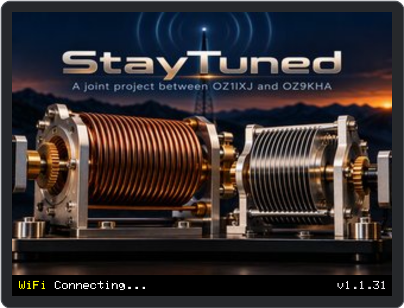

2. **Touch Calibration** (first boot only):
   - Follow on-screen prompts to tap calibration targets
   - Calibration data is saved and reused on subsequent boots

3. **WiFi Configuration** (if enabled):
   - If no saved WiFi credentials, device creates access point: **"StayTuned"**
   - Password: **"staytuned2026"**
   - Connect and configure WiFi via captive portal
   - On successful connection, the web page and OTA updates are available at `staytuned.local`

4. **Automatic Homing**:

   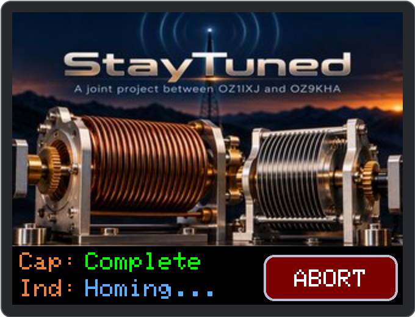

   - Each motor runs to its limit switch. The startup picture stays, with a strip at the bottom showing "Waiting..." → "Homing..." → "Complete" or "FAILED" per motor (Cap, Ind)
   - **ABORT** stops homing (the tuner then shows the failure screen with **Reboot**)
   - Sequence per motor:
     - If the limit switch is already active, the motor first backs off until the switch clears
     - It then approaches the switch slowly and stops the moment it triggers: this is position 0
     - The **Home Offset** setting (default 0) is applied after that
   - If homing fails, check:
     - Limit switch wiring (GPIO 32 for Motor 1, GPIO 33 for Motor 2)
     - Switches must deactivate after backing off (not stuck/shorted)
     - Motor power supply (12-24V)
     - No mechanical obstructions
     - **Homing Dir** in Settings, if the switch sits at the other end of the travel

   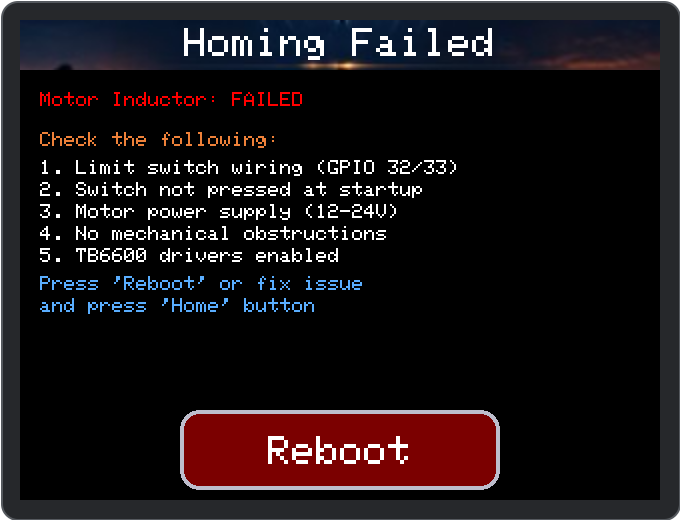

   The failure screen lists which motor failed and what to check; tap **Reboot** to try again.

5. **Ready to Use**: System displays the Main Screen

---

## Typical Workflow

The first time you set up the tuner, and whenever you add an antenna or band, work through these steps. After that, day-to-day operation is step 5 only.

**1. Set the travel limits** (once). In Manual mode, move each motor to the end of its useful range, then ⚙ → Settings → **Hardware Calibration** → **Set at Current** for that motor. Every move is limited to 0 … end position. See [Hardware Calibration](#hardware-calibration).

**2. Make a preset per band.** In Manual mode, tune for a low SWR (or use **AUTO-TUNE**), open ⚙ → **Presets** → **Save**, type a name and enter the band's **Min kHz / Max kHz**. The frequency range is what lets auto mode pick the preset by itself.

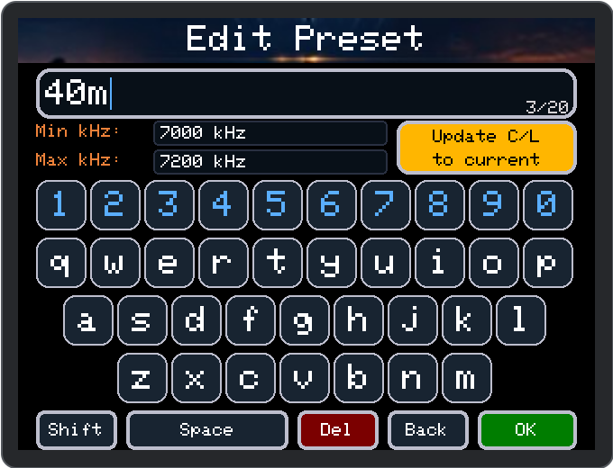

**3. Put the presets on buttons.** In the preset list tap **Assign** on a row and choose one of the 12 on-screen buttons (and/or a hardware button).

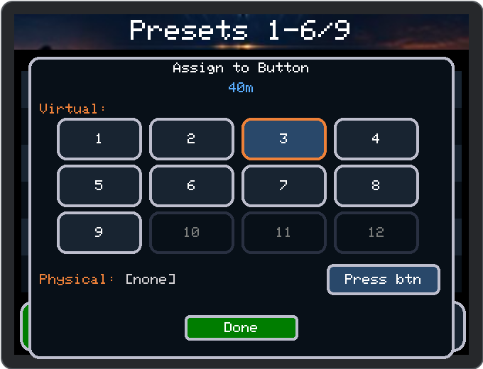

**4. Build the frequency memory.** In Preset mode load the band's preset, key the radio at low power (inside the auto-tune power window, default 1-20 W) on a frequency you use, and tap **FINE TUNE**. The tuner refines C and L, and stores the result for that frequency. Repeat for the frequencies you use most; each one takes a few seconds the first time and none after that.

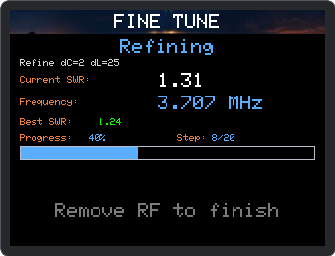

**5. Operate.** Hold **FINE TUNE** for about 0.6 s to switch to auto mode (the button now reads **AUTO / MEM**). Now just transmit: on each new frequency the tuner moves to the stored memory point, or to the preset whose range covers the frequency.

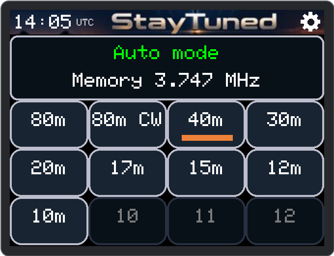

> **Tip**: Key the radio at low power when you change frequency. Above the auto-tune maximum power the tuner does not move the motors while you transmit; it shows **Release key** and moves as soon as you unkey.

---

## Main Screen

The Main Screen is the primary interface and has two layouts depending on the operating mode.

### Screen Layout - Preset Mode


| Area | Where | What it shows / does |
|------|-------|----------------------|
| **Clock** | Header, left | UTC time once WiFi has synced it (NTP) |
| **Gear ⚙** | Header, right | Opens the menu; yellow while the menu is open |
| **SWR** | Top left box | SWR as a number: green ≤ SWR Good (1.5), yellow ≤ SWR Caution (2.0), red above or while the alarm is active |
| **FINE TUNE** | Top centre | Tap: fine tune from the active preset. Hold ~0.6 s: auto mode on/off. Red **TX** while you transmit |
| **Power** | Top right box | Forward, reflected and forward PEP power in watts |
| **Preset buttons 1-12** | Grid | Dark slate with a silver rim and the preset name when assigned, almost black with the number when free. The bar at the bottom of the active preset is sky blue while the motors move and copper-orange once they are there |

The FINE TUNE button changes with the state of the tuner:

| Fine tune mode | Auto mode | Transmitting |
|:--:|:--:|:--:|
|  | 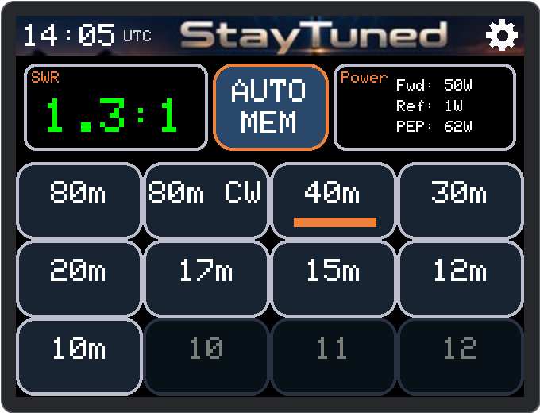 | 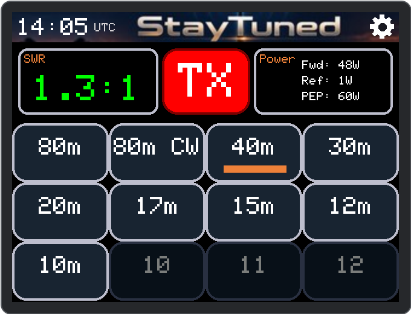 |
| Steel-blue **FINE TUNE**: tap to refine the active preset | **AUTO / MEM** (copper rim): the tuner follows your transmit frequency | Red **TX** while RF is detected |

Without the RF meter board the button is grey and does nothing.

### Screen Layout - Manual Mode

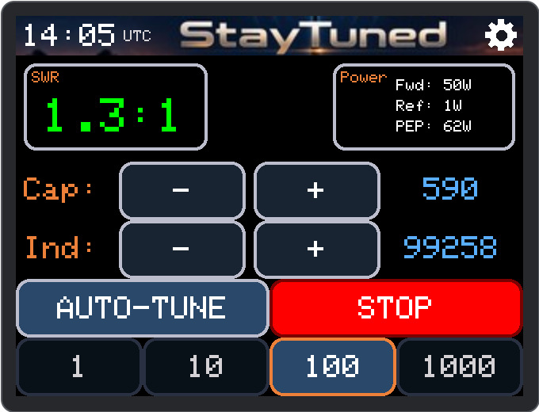

| Area | What it does |
|------|--------------|
| **Cap: − / +** | Move the capacitor by the selected step; hold for continuous movement |
| **Ind: − / +** | Move the inductor by the selected step; hold for continuous movement |
| **Positions** (sky blue, right) | Current capacitor and inductor positions in steps |
| **AUTO-TUNE** | Starts an automatic tune from scratch (see [Auto-Tune](#auto-tune)); grey without the RF meter board |
| **STOP** | Stops both motors at once (also ends continuous movement) |
| **1 / 10 / 100 / 1000** | Step size; the selected one is green. In continuous movement it also sets the speed |

There is no manual Home button: homing runs automatically at boot. To re-home, reboot (About → Reboot) or power-cycle the tuner.

### Header Elements

- **Clock**: UTC time (`HH:MM`), main screen only, shown once the time has been synced over WiFi
- **Title**: the StayTuned heading on the main screen, the name of the screen elsewhere
- **Gear Icon (⚙)**: opens the menu (main screen only)

### SWR Display

- **Numeric Value**: large ratio, e.g. "1.3:1"
- **Color Coding** (thresholds set in Settings):
  - 🟢 **Green**: SWR ≤ SWR Good (default 1.5)
  - 🟡 **Yellow**: up to SWR Caution (default 2.0)
  - 🔴 **Red**: above SWR Caution, or while the SWR alarm is active

### Power Display

- **Fwd**: forward (transmitted) power in watts
- **Ref**: reflected power in watts
- **PEP**: forward peak envelope power in watts
- Values update about every 50 ms

---

## Operating Modes

StayTuned has two distinct operating modes that change the Main Screen layout:

### Preset Mode (Default)

**Purpose**: Quick recall of saved antenna tuning positions

**Features**:
- 12 quick-access buttons in 3×4 grid
- Each button can be assigned to a saved preset
- One-touch preset loading
- SWR alarms are **ACTIVE** in this mode
- Status indicators show active preset and motor status
- If a MCP23017 port expander is fitted, up to 16 physical hardware buttons can also activate presets independently of the touchscreen mode

**Use Case**: Operating with known frequencies/bands where presets have been saved

**Switching**: Tap ⚙ → tap the **Preset | Manual** switch (top row) → Switches to Manual Mode

### Manual Mode

**Purpose**: Fine-tuning antenna positions and saving new presets

**Features**:
- Independent +/- control for capacitor and inductor
- Variable step size (1, 10, 100, 1000 steps)
- **Continuous mode**: Hold any motor button to run continuously
- **Variable speed control**: Speed scales with step size selection
- **Real-time speed adjustment**: Change speed while motor running
- Real-time position display
- AUTO-TUNE and Stop buttons (no manual Home button — homing runs automatically at boot)
- SWR alarms are **DISABLED** in this mode (high SWR expected during tuning)

**Use Case**: 
- Tuning for new frequencies
- Fine-tuning existing presets
- Exploring optimal positions

**Switching**: Tap ⚙ → tap the **Preset | Manual** switch (top row) → Switches to Preset Mode

---

### Continuous Mode (Manual Mode Feature)

**Purpose**: Run motors continuously for fast positioning without repeated button taps

**Activation**:
1. Select desired step size (1, 10, 100, or 1000)
2. **Press and hold** any motor button (Cap+, Cap-, Ind+, or Ind-)
3. After **400ms**, motor enters continuous mode and runs at controlled speed
4. Motor continues until:
   - Button is released
   - Stop button is pressed
   - Motor reaches limit

**Speed Control**:
Motor speed is scaled from the motor's Speed setting (MC Speed / ML Speed) by the selected step size:

| Step | Speed | Use |
|------|-------|-----|
| **1** | 25 % | Very precise, slow movement |
| **10** | 50 % | Fine adjustments |
| **100** | 75 % | Fast positioning |
| **1000** | 100 % | Coarse movements |

**Real-Time Speed Adjustment**:
While motor is running in continuous mode:
1. Simply **tap any step size button** (1, 10, 100, 1000)
2. Motor speed smoothly transitions to the new speed
3. AccelStepper's acceleration profile ensures smooth changes
4. No need to stop and restart - speed changes on-the-fly
5. Serial monitor shows: "Speed adjusted to XX% (step size: X)"

**Example Workflow**:
1. Hold **Cap+** with step **1** selected → Motor starts slowly (25% speed)
2. While still holding, tap **100** button → Speed smoothly ramps up to 75%
3. Tap **1000** button → Accelerates to 100% maximum speed
4. Tap **10** button → Smoothly decelerates to 50% speed
5. Release button → Motor stops, original speed restored

**Technical Details**:
- **Hold threshold**: 400ms (optimized for resistive touchscreen)
- **Drift tolerance**: 30 pixels (allows natural finger movement during hold)
- **Touch polling**: 50ms interval (minimal overhead ~10-20µs per check)
- **Speed restoration**: Original max speed automatically restored when continuous mode exits
- **Smooth transitions**: AccelStepper library handles acceleration/deceleration curves

**Tips**:
- Continuous mode works with all four motor buttons independently
- Step size button highlighting updates when speed changes
- Stop button provides emergency halt during continuous operation
- Original motor speed configuration preserved - settings not affected
- Ideal for initial positioning (fast with 1000), then switch to precise adjustments (slow with 1)

---

## Button Reference

### Main Screen - Preset Mode

| Button | Location | Function |
|--------|----------|----------|
| **1-12** | Center grid | Quick-access preset buttons. Tap to load assigned preset. |
| **FINE TUNE / AUTO MEM** | Top center, between the SWR and power boxes | **Tap**: fine tune from the active preset (see [Frequency Memory](#frequency-memory-fine-tune)). **Hold ~0.6 s**: switch between fine tune and auto mode (**AUTO / MEM**, see [Auto Mode](#auto-mode)). Shows a red **TX** while transmitting; grey and inactive without the RF meter board |
| **Clock** | Top-left of the header | Time in UTC (`HH:MM`), shown once WiFi has synced the time (NTP). Main screen only |
| **⚙ (Gear)** | Top-right | Opens the menu (Preset/Manual switch, Presets, SD Card, Settings, About); turns yellow while the menu is open |
| **Assigned Preset** | Varies | Shows preset name. Tap to load. Status bar shows movement. |
| **Unassigned** | Varies | Shows number only. Assign via Preset List screen. |

### Main Screen - Manual Mode

| Button | Location | Function |
|--------|----------|----------|
| **Cap -** | Left, Row 1 | **Tap**: Decrease capacitor by step size<br>**Hold 400ms**: Continuous backward movement at variable speed |
| **Cap +** | Right, Row 1 | **Tap**: Increase capacitor by step size<br>**Hold 400ms**: Continuous forward movement at variable speed |
| **Ind -** | Left, Row 2 | **Tap**: Decrease inductor by step size<br>**Hold 400ms**: Continuous backward movement at variable speed |
| **Ind +** | Right, Row 2 | **Tap**: Increase inductor by step size<br>**Hold 400ms**: Continuous forward movement at variable speed |
| **AUTO-TUNE** | Left half, Row 3 | Launch automatic tuning (see [Auto-Tune](#auto-tune)) |
| **STOP** | Right half, Row 3 | Emergency stop - halt all motor movement (also stops continuous mode) |
| **1** | Row 4, Col 1 | Set step size to 1 (fine adjustment, 25% speed in continuous mode) |
| **10** | Row 4, Col 2 | Set step size to 10 (50% speed in continuous mode) |
| **100** | Row 4, Col 3 | Set step size to 100 (75% speed in continuous mode) |
| **1000** | Row 4, Col 4 | Set step size to 1000 (coarse adjustment, 100% speed in continuous mode) |
| **⚙ (Gear)** | Top-right | Opens the menu (Preset/Manual switch, Presets, SD Card, Settings, About) |

**Note**: Step size buttons can be tapped **during continuous mode** to change speed in real-time without releasing the motor button.

### Preset List Screen

| Element | Location | Function |
|---------|----------|----------|
| **Preset Row** | Center | Shows preset name, positions, SWR. Tap to load preset; hold ~0.6 s to edit it. |
| **[Assign]** | Middle | Tap to assign preset to on-screen quick-access buttons (1-12) and/or physical hardware buttons |
| **Waste bin** | Right | Delete preset (confirmation not required) |
| **Save** | Bottom row, 1st | Save current motor positions as new preset |
| **Back** | Bottom row, 2nd | Return to Main Screen |
| **▲ / ▼** | Bottom row, 3rd and 4th | Scroll the list one row up or down (grey at the top or bottom of the list). With more than 6 presets the title shows which are visible, e.g. `Presets 7-12/15` |

### Settings Screen

Each value row has **−** (maroon) and **+** (green) buttons; on/off and direction rows have one toggle button. The screen scrolls: swipe up and down. All settings, their ranges and defaults are in [Settings & Configuration](#settings--configuration).

| Element | Function |
|---------|----------|
| **− / +** | Change the value by one step |
| **Toggle** (Homing Dir, Motor Auto-Disable) | Tap to switch |
| **Touch Calibration / Hardware Calibration** | Open the calibration screens |
| **WiFi: Enabled / Disabled** | WiFi on or off after the next reboot |
| **Forget WiFi Credentials** | Clear the saved network (confirmation) |
| **Clear Freq Memory (n)** | Delete all stored frequencies (confirmation) |
| **Factory Reset** | Erase all settings (confirmation) |
| **Back** | Return to the Main Screen |

### Calibration Screen

| Button | Function |
|--------|----------|
| **Set at Current** (Cap / Ind) | Use the motor's current position as its end position |
| **Reset to Defaults** | Reset both end positions to the defaults |
| **< / >** | Select the band for the RF meter power calibration |
| **− / +** (Forward, Reflected) | Change the band's calibration factor; the navy button sets the step (x1, x10, x100) |
| **Save To RF Meter** | Write the calibration to the RF meter board |
| **− / +** (PPM) and **Save PPM To RF Meter** | Frequency correction of the RF meter |
| **Back** | Return to Settings |

### Auto-Tune Screen

| Button | Function |
|--------|----------|
| **ABORT** | Shown while tuning is in progress (maroon) — stops the motors immediately |
| **DONE** | Shown once tuning has ended (green); the status line above says whether it converged. Returns to the Main Screen |

### SD Card Screen

| Button | Function |
|--------|----------|
| **Save Settings** | Save display, motor and SWR configuration to a new dated (or sequentially-numbered) file — never overwrites a previous save |
| **Load Settings** | Shows a scrollable list of saved settings files (newest first) — tap one to load it |
| **Save Presets** | Save all presets (including on-screen and physical button assignments) to a new dated file |
| **Load Presets** | Shows a scrollable list of saved preset files (newest first) — tap one to load it |
| **Back** | Return to the Main Screen |

### On-Screen Keyboard

| Area | Function |
|------|----------|
| **QWERTY Layout** | Full keyboard with numbers, letters, space |
| **Shift** | Toggle uppercase/lowercase |
| **Del** | Delete last character (bottom row for the name; on the keypad for kHz) |
| **Back** | Leave without saving and return to the preset list |
| **Update C/L** | Edit only: sets this preset's C/L to the current motor positions (and SWR) after a warning showing stored vs. current C/L. Saved with OK, discarded with Back |
| **OK** | Confirm text entry and save |

---

## Menu System

### Accessing the Menu

Tap the **⚙ (Gear Icon)** in the top-right corner of the Main Screen.

### Menu Options

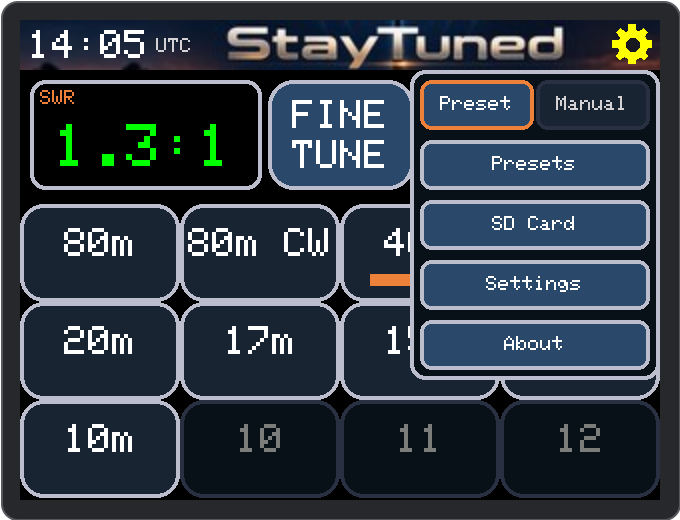

| Item | Opens / does |
|------|--------------|
| **Preset \| Manual** | Mode switch: the current mode is lit green; tap to switch between Preset and Manual mode |
| **Presets** | Preset List Screen (blocked while transmitting) |
| **SD Card** | SD Card Screen |
| **Settings** | Settings Screen |
| **About** | About Screen (versions, RF meter, firmware updates, reboot) |

**Button colours** are the same on every screen (all buttons have a silver rim): green = OK / Done / Save / Yes, dark slate = Back / Cancel / No, maroon = delete, clear, reset or abort, orange with black text = caution (Overwrite, Skip), steel blue = opens a screen or runs a feature. A selected option (step size, Shift, Preset / Manual) is steel blue with a copper rim; an unavailable button is dim. Labels are copper and values sky blue.

**To close menu**: Tap anywhere outside the menu box or select an option.

---

## Preset Management

### What is a Preset?

A preset stores:
- Motor 1 position (Capacitor)
- Motor 2 position (Inductor)
- Preset name (up to 20 characters)
- Frequency range, **Min kHz / Max kHz** (optional). Auto mode uses it to pick the preset for your transmit frequency
- Last measured SWR (measured in use)

### Saving a New Preset

1. **Switch to Manual Mode** (if not already): ⚙ → **Preset | Manual** switch
2. **Adjust motors** to desired position using +/- buttons
3. **Verify SWR** is acceptable
4. **Open Presets**: ⚙ → "Presets"
5. **Tap "Save"** button
6. **Enter name** using on-screen keyboard (e.g., "20m CW", "40m Phone")
7. Optional: tap **Min kHz** / **Max kHz** and type the band edges on the keypad
8. **Tap "OK"** to save

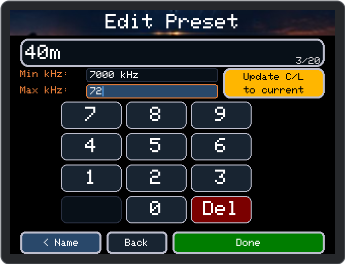

### Loading a Preset

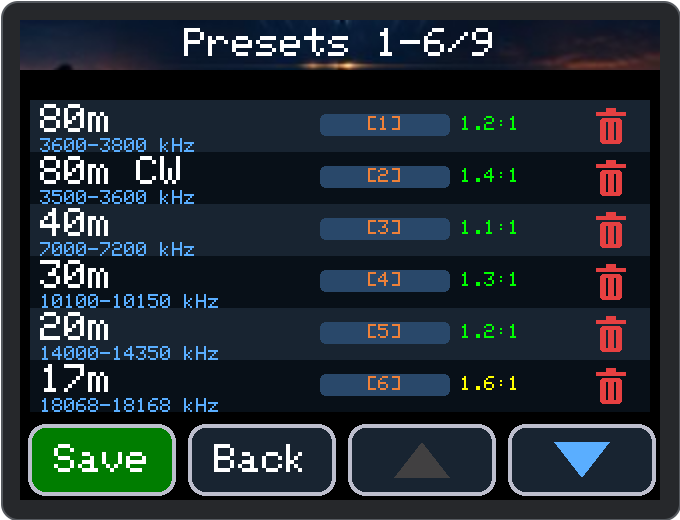

**Method 1: From Preset List**
1. ⚙ → "Presets"
2. Tap preset row
3. Motors move to saved positions
4. Returns to Main Screen

**Method 2: Quick-Access Button (Preset Mode only)**
1. Ensure preset is assigned to a button (see below)
2. From Main Screen, tap assigned button (1-12)
3. Motors move immediately to saved positions
4. Button shows status:
   - **Blue bar**: Motors moving
   - **Copper-orange bar**: Motors at position

**Method 3: Physical Hardware Button (requires MCP23017 port expander)**
1. Ensure the physical button is assigned to a preset (see *Assigning Presets* below)
2. Press the physical button at any time (system must not be transmitting)
3. Motors move to the assigned preset positions
4. The corresponding on-screen preset button lights up (if also assigned)

### Assigning Presets to Quick-Access Buttons

1. ⚙ → "Presets"
2. Find preset in list
3. Tap **[Assign]** area (middle of row)
4. The assignment dialog opens, showing two sections:


**Virtual Buttons (1–12)**:
- Shows the 12 on-screen quick-access buttons in a 3×4 grid
- **Steel blue with a copper rim** = already assigned to this preset
- **Slate with a silver rim** = assigned to a different preset
- **Dim** = unassigned
- Tap a button number to toggle its assignment

**Physical Buttons** (only shown if MCP23017 port expander is detected):
- Shows currently assigned hardware button numbers (e.g. "3,7") or "[none]"
- Tap **[Press btn]** to enter listen mode — the button turns red and shows "Cancel"
- Press any physical hardware button on your panel; its assignment to this preset is toggled immediately
- Tap **[Cancel]** to exit listen mode without making a change

5. Tap **Done** to close the dialog
6. All assignments are saved automatically

**Notes**:
- One preset can be assigned to multiple on-screen or physical buttons
- Assignments persist across power cycles (stored in NVS flash)
- If no MCP23017 port expander is fitted, the Physical Buttons section does not appear

### Deleting a Preset

1. ⚙ → "Presets"
2. Find preset in list
3. Tap red **[X]** on right side
4. Preset deleted immediately (no confirmation)
5. Any on-screen and physical button assignments for this preset are automatically cleared; all other assignments are shifted to remain consistent

### Editing a Preset

1. ⚙ → "Presets"
2. **Tap and hold** the preset row for about 0.6 s (a short tap loads it instead)
3. The keyboard opens as **Edit Preset** with the current name and frequency range filled in
4. Change the name and/or the **Min kHz** / **Max kHz** fields
5. Optional: tap **Update C/L** to take the current motor positions (and SWR), e.g. after
   re-tuning the band in Manual Mode. A warning shows the stored and current C/L; tap
   **Overwrite** to accept or **Cancel**. The button then shows the new C/L, which is saved
   only when you press **OK**

   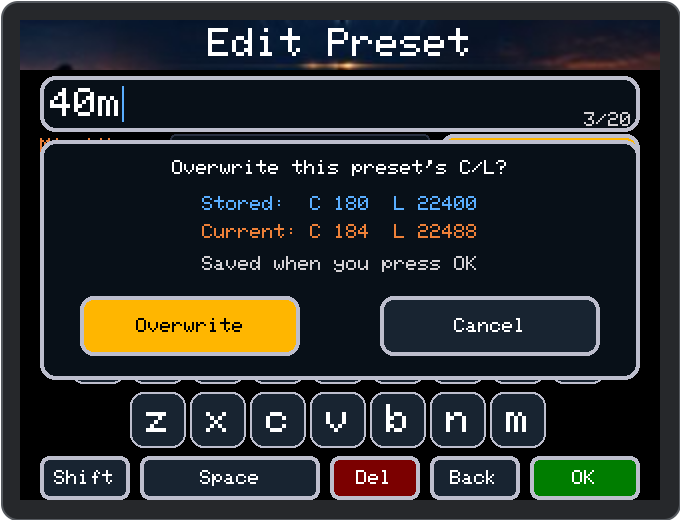
6. Tap **OK** to save, or **Back** to leave without changes

The preset keeps its place in the list and its button assignments. A name that another preset
already uses is rejected, and Min kHz must not be above Max kHz.

To clear a kHz value, tap the field and **Del** all digits.

### Preset List Display

Each preset row shows:
- **Name**: User-defined preset name, with the frequency range below it in sky blue
- **[Assign]**: Button assignment area: the assigned button numbers in copper, e.g. `[3]`, or `Assign`
- **SWR**: coloured like the main screen value (green / yellow / red); the last SWR measured on the preset's position. A preset saved without RF shows none. The first time you transmit after loading the preset (motors still at its position, frequency inside its range), the tuner measures the SWR (5 readings) and stores it if it differs by more than 0.1 from the stored value. It is saved once you unkey. The value is measured again on each later visit to the preset.
- **Waste bin**: Delete button

### Storage Limits

- **Maximum presets**: 50
- **Storage**: Internal flash memory (persistent)
- **Backup**: Optional SD card export/import (settings and presets saved separately)

---

## Settings & Configuration

Access via: ⚙ → **Settings**. The screen scrolls: swipe up for later rows, down to go back. Every change is saved at once and kept across reboots. The same settings are on the web page's **Settings** tab.

| Top of the list | End of the list |
|:--:|:--:|
| 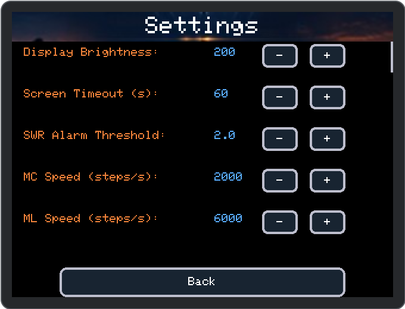 | 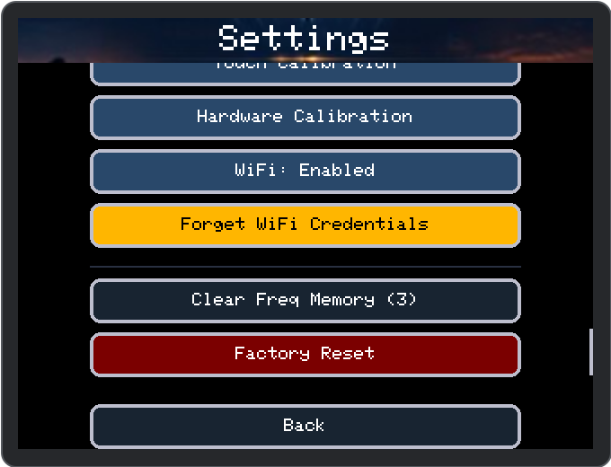 |

MC = capacitor motor (Motor 1), ML = inductor motor (Motor 2).

### Display and SWR

| Setting | Range | Default | Step | What it does |
|---------|-------|---------|------|--------------|
| **Display Brightness** | 20-255 | 200 | 20 | Backlight level, takes effect at once |
| **Screen Timeout (s)** | Always On, 10-3600 | 60 | 10 | Backlight off after this long without a touch (see below) |
| **SWR Alarm Threshold** | 1.0-10.0 | 2.0 | 0.1 | Above this SWR the alarm sounds and the popup shows (Preset mode). Also sent to the RF meter board |
| **SWR Good (Green)** | 1.0-3.0 | 1.5 | 0.1 | Up to this SWR the value is green |
| **SWR Caution (Yellow)** | 1.0-5.0 | 2.0 | 0.1 | Up to this SWR the value is yellow, above it red |

**Screen timeout**: the countdown starts when the main screen appears after a boot. A tap wakes the screen; that tap is ignored, so it cannot press a button by accident. Transmitting keeps the screen on (the countdown restarts when you unkey), and a hardware preset button wakes it too.

### Motors

| Setting | Range | Default | Step | What it does |
|---------|-------|---------|------|--------------|
| **MC / ML Speed (steps/s)** | 100-10000 | 2000 | 200 | Maximum speed of each motor for preset moves, jogging and tuning. Lower is quieter, higher is faster |
| **MC / ML Accel (steps/s^2)** | 100-5000 | 1000 | 100 | How quickly each motor reaches its speed. Lower is gentler on the mechanics |
| **MC / ML Backlash (steps)** | 0-1000 | 0 (off) | 1 | Extra steps on every direction reversal (see below) |
| **Motor Auto-Disable** | On / Off | On | toggle | Switches the driver current off 0.5 s after a motor stops. The capacitor and roller inductor hold their position by themselves, so this only saves heat and power. Turn it off if a motor drifts when it is not powered |

**Backlash compensation**: with microstepping (e.g. 1/8), a motor turning against friction lags slightly behind its commanded position. After a direction change the first steps only take up that lag, so the first move after a reversal is shorter than the following ones. This is magnetic/electrical, not mechanical slack, and grows with load torque.

- **Effect**: on every direction reversal the motor runs this many extra steps in the new direction. They are **not** counted: the displayed position, saved presets and the web/REST position always show the value you asked for. Moves in the same direction are unaffected. The compensation resets after homing, and is reduced near the 0/end limits so the motor never runs past them.
- **How to measure**:
  1. Set the motor's backlash to 0.
  2. On the Manual screen, jog a few times in one direction, then reverse.
  3. Compare how far the first move after the reversal travels with a normal move of the same size. The difference (in steps) is the value to enter.
  4. Repeat +10 ×3, −10 ×3, +10 ×3: every move should now travel the same distance and the position should return to its start value.
- **Tip**: raising the TB6600 current (within the motor's rating) or reducing friction lowers the lag and therefore the value needed. Leave a motor that does not show the problem at 0.

### Homing

| Setting | Range | Default | Step | What it does |
|---------|-------|---------|------|--------------|
| **MC / ML Homing Speed (steps/s)** | 100-2000 | 4000 ¹ | 50 | Speed of the final approach to the limit switch at boot. Slow it down if a motor overshoots its switch |
| **MC / ML Home Offset (steps)** | -5000 to 5000 | 0 | 10 | Moves position 0 away from the switch after homing. Use it when the switch triggers before the true end of the travel |
| **MC / ML Homing Dir** | Normal / Inverted | Normal | toggle | **Normal**: the limit switch is at the maximum end of the travel (e.g. maximum inductance). **Inverted** (orange): the switch is at the minimum end. Position 0 is always at the switch and positions grow away from it |

¹ The factory value is above the adjustable range; the first tap on − or + brings it inside the range.

> **Note**: Homing settings take effect at the next homing, that is after a reboot.

### Auto-tune and frequency memory

| Setting | Range | Default | Step | What it does |
|---------|-------|---------|------|--------------|
| **Tune Target SWR** | 1.1-3.0 | 1.5 | 0.1 | A tune stops refining once the SWR is at or below this |
| **Tune L Sweep (st/s)** | 100-4000 | 1000 | 100 | Inductor speed while AUTO-TUNE sweeps for a dip. Slower finds narrow dips more reliably |
| **Tune Max Time (s)** | 60-1200 | 600 | 60 | A tune that has not finished by then stops |
| **Tune Min Power (W)** | 0.1-10.0 | 1.0 | 0.5 | Below this power the tune pauses and waits for RF |
| **Tune Max Power (W)** | 1-100 | 20 | 5 | Above this power a tune aborts, and auto mode waits for you to unkey before it moves |
| **Tune Settle (ms)** | 100-2000 | 300 | 50 | Wait after each move before the SWR is read |
| **Freq Memory** | On / Off | On | toggle | Store the result of each fine tune per frequency, and use stored points |
| **Mem Window (kHz)** | 1-20 | 3 | 1 | How close the transmit frequency must be to a stored frequency to use it |
| **Mem Store SWR** | 1.0-3.0 | 1.5 | 0.1 | Only results at or below this SWR are stored |

### Buttons at the end of the list

| Button | What it does |
|--------|--------------|
| **Touch Calibration** | Recalibrate the touchscreen: follow the prompts and tap the targets (about 30 s). Use it if touches land beside the buttons |
| **Hardware Calibration** | Motor end positions, RF meter power calibration and frequency correction (see [Calibration](#calibration)) |
| **WiFi: Enabled / Disabled** | Turns WiFi on or off at the next boot. When disabled, WiFi, the web server, telnet and OTA stay off; boot is slightly faster |
| **Forget WiFi Credentials** (orange) | Clears the saved network after a YES/NO confirmation; the tuner starts its setup access point at the next boot |
| **Clear Freq Memory (n)** | Deletes all n stored frequencies after the question "Really delete all n stored frequencies?" (CLEAR / CANCEL; no answer within 10 s cancels). With an empty memory it shows "Nothing to clear" |
| **Factory Reset** (maroon) | After a RESET/CANCEL confirmation, erases the WiFi credentials, display settings and touch calibration, motor settings and calibration, button assignments and the RF meter calibration copy, then restarts. The presets file, the auto-tune settings and the frequency memory are kept; save to SD card first if you want a full backup |
| **Back** | Return to the Main Screen |

The three confirmations look alike: the question, a maroon button that does it and a grey CANCEL.

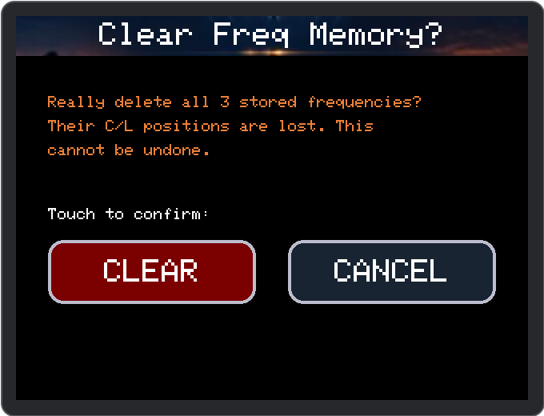

---

## Calibration

### Touch Calibration

**Purpose**: Ensure accurate touchscreen response

**When needed**:
- First power-up
- After firmware update
- If touches are offset or unresponsive

**Process**:
1. White crosshair appears at screen corner
2. Tap center of crosshair precisely
3. Repeat for 5 positions (corners + center)
4. Calibration saved to flash memory
5. Returns to previous screen

**Tips**:
- Use stylus or fingernail for precision
- Tap firmly but briefly
- If calibration seems wrong, redo from Settings

### Hardware Calibration

**Purpose**: Configure motor travel limits and verify limit switches

**Access**: ⚙ → Settings → "Hardware Calibration"

#### Calibration Screen Layout

The screen scrolls: motor limits at the top, then the RF meter power calibration and the frequency correction.

| Motor travel limits | RF meter calibration |
|:--:|:--:|
| 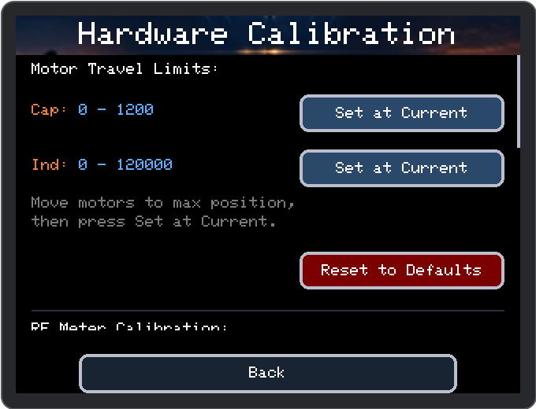 | 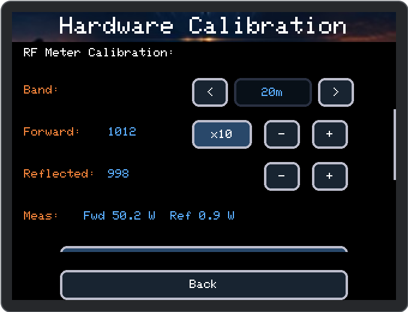 |

#### Setting Motor End Positions

The "End Position" defines the maximum travel distance from the home position (limit switch).

**Procedure**:
1. Move the motor to its maximum position (Manual Mode)
2. Open Hardware Calibration and tap **"Set at Current"** on that motor's row
3. The current position is saved as the end position
4. Every move is limited to 0 … end position, which prevents over-travel damage. The frequency memory stays in use: entries beyond a new, smaller end are marked for re-tune when used

**Default**: 500,000 steps, which is effectively no limit. Set both end positions before you use the tuner, so a move can never drive the mechanics into its end stop.

#### Resetting to Defaults

Tap **"Reset to Defaults"** (maroon, below the two **Set at Current** buttons) to set both end positions back to 500,000 steps.

#### Power Calibration (RF meter)

The **RF Meter Calibration** section sets a forward and a reflected
correction factor per band (×1000, so 1000 = no correction, 1100 = reads
10 % higher). You need a reference wattmeter in line with a dummy load.

**Procedure**:
1. Key a steady carrier on the band to calibrate. While a carrier is present,
   **Band** follows the measured frequency, because the meter applies the
   factors of the band it measures.
2. **Meas** shows the forward and reflected power the meter reads, refreshed
   about twice a second.
3. Tap the step button on the Forward row (**x1 / x10 / x100**, shared by
   Forward and Reflected), then use **−** / **+**. Each tap takes effect on
   the meter immediately (status "Preview - not saved"), so Meas follows.
4. Repeat until Meas matches the reference wattmeter.
5. Tap **Save To RF Meter** to store the band's factors in the meter
   ("Saved to RF meter"). An unsaved value is lost when the meter restarts.
6. Repeat for each band you use. Reflected is calibrated the same way, with
   a known reflected power (e.g. the coupler reversed).

Allowed range per factor: 100–10000.

#### Frequency Correction (RF meter)

Scroll to the bottom of the screen. The RF meter times its frequency
measurement from an internal oscillator that can be off by 1–2 %. The
**PPM** value corrects every frequency reading by that ratio. The meter
stores it, so it survives power cycles.

**Procedure**:
1. Key a carrier at a known frequency. A higher band gives a finer result, e.g. 28.000 MHz.
2. **Meas** shows the frequency the meter reads. It refreshes by itself about twice a second.
3. Tap the step button (**x1 / x10 / x100 / x1000**) to pick the step size, then use **−** / **+** to adjust PPM. A positive PPM raises the reading.
   Each tap takes effect on the meter immediately (status "Preview - not saved"), so Meas follows.
4. Repeat until Meas matches the carrier.
5. Tap **Save PPM To RF Meter** to store it in the meter. An unsaved value is lost when the meter restarts.

Starting from the current value, the exact correction is
`new = (1000000 + old) × f_true / f_read − 1000000`. For example, 28.000 MHz
read as 27.860 MHz at 0 ppm gives +5025. The allowed range is ±30000 ppm.

#### Verifying Limit Switches

**Homing sequence** (at every boot):
1. If the switch is already active, the motor backs off until it clears
2. It approaches the switch slowly and stops the moment it triggers
3. The **Home Offset** (default 0) is applied
4. That position becomes 0

**Testing**:
1. Reboot (About → **Reboot**) or power-cycle the tuner
2. Observe homing status screen
3. Both motors should show "Complete" in green
4. If "FAILED" appears:
   - Check wiring (GPIO 32, GPIO 33)
   - Verify switches activate when pressed (LOW when pressed)
   - **Important**: If switch stuck active, motor backs off then tries again
   - Verify the switch deactivates when the motor backs off
   - Check motor power (12-24V) and TB6600 drivers
   - If backoff fails, switch may be shorted or mechanically stuck

**Adjusting Homing Position**:
- Use the **MC / ML Home Offset** settings to fine-tune the final home position
- Positive offset = further from limit (safer)
- Test after adjustment by power cycling and re-homing

**Inverting Homing Direction**:
- If a motor homes in the wrong direction (moves away from its limit switch), set the corresponding **MC / ML Homing Dir** to **Inverted** in Settings
- This reverses the direction of the initial sweep and pre-backoff move
- Useful when a motor is physically mounted in reverse, or wired with DIR signal inverted at the TB6600
- Setting is saved to flash and takes effect on the next homing sequence

---

## Auto-Tune

**Purpose**: Automatically find the capacitor and inductor positions with the lowest SWR, the same way you would tune by hand.

**Access**: Main Screen → Manual Mode → tap **AUTO-TUNE**

**Before you start**:
- Motors must have completed homing successfully, and the RF meter must be connected
- Transmit a **low-power carrier** (CW or FM) on the frequency to tune, between the min and max tune power (default 1-20 W)
- The tune waits up to 60 s for the carrier to appear after you tap AUTO-TUNE

### How It Works

1. **Dip search**: the capacitor is set to 50 % capacitance and the roller inductor runs slowly across its whole travel while the SWR is sampled. As soon as a clear **dip** in SWR has been passed, the inductor stops. If no dip is seen, the capacitor is moved to 75 %, then 25 %, 100 % and 0 %, sweeping the inductor each time (alternating direction, so no time is lost returning).
2. **Refinement**: starting at the dip, C and L are adjusted **together** (they influence each other) with a pattern search that shrinks its steps as it closes in on the lowest SWR.
3. **Finish**: the motors move to the best position found and a final reading decides the result.

If the SWR at the start is already 3.0 or lower, the dip search is skipped and the tuner refines from where it is - fast when you have only moved a little in frequency.

### Auto-Tune Screen Layout

| While tuning | Finished |
|:--:|:--:|
| 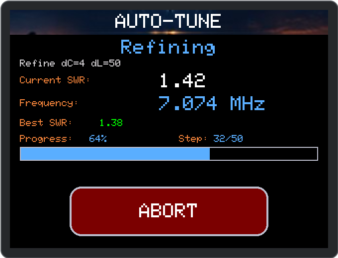 | 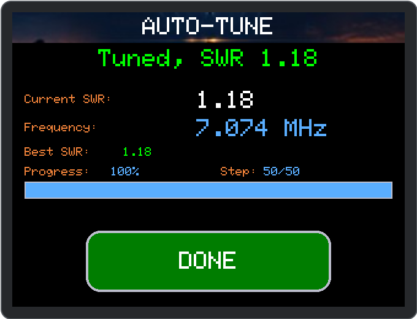 |

- **Status** (large, top): sky blue while tuning, green when converged, red on failure or too much power
- **Detail line**: what the tuner does right now, e.g. the dip search attempt or the refinement step sizes
- **Current SWR**, **Frequency** (from the RF meter), **Best SWR** so far
- **Progress** bar and **Step** count
- **ABORT** while it runs, **DONE** when it has ended

A **fine tune** uses the same screen with the title **FINE TUNE**. Once the first carrier has been seen it shows "Remove RF to finish" instead of ABORT: unkey to end it.


The second line shows what the tuner is doing right now: the dip search attempt and sweep progress, or the refinement step sizes (`Refine dC=8 dL=120 SWR 1.32`). **Step** counts dip-search attempts (of 5), then refinement evaluations.

**Results**:
| Result | Meaning |
|--------|---------|
| **Converged** (green) | Best SWR is at or below the target SWR |
| **Failed: No dip found** | None of the five capacitor settings gave a dip; motors return to where they started |
| **Failed: Best SWR x.x (target y.y)** | Motors are at the best position found, but it is above the target |
| **Failed: Timeout / RF power lost / No RF power** | The time limit was reached, or the carrier stopped for more than 10 s |
| **Aborted** | Stopped with ABORT, too much power, or the SWR ran away during refinement |

**Aborting**: Tap **ABORT** at any time. The motors stop where they are (not necessarily at the best position found).

**Saving the result**: after a successful tune, save the position as a preset as usual.

### Auto-Tune Settings

On the Settings screen (locked while a tune runs):

| Setting | Default | Range | Effect |
|---------|---------|-------|--------|
| Tune Target SWR | 1.5 | 1.1 - 3.0 | Result counts as Converged at or below this |
| Tune L Sweep (st/s) | 1000 | 100 - 4000 | Inductor speed during the dip search: slower finds narrow dips more reliably, faster saves time |
| Tune Max Time (s) | 600 | 60 - 1200 | Overall time limit |
| Tune Min Power (W) | 1.0 | 0.1 - 10 | Below this the tune pauses |
| Tune Max Power (W) | 20 | 1 - 100 | Above this auto-tune aborts immediately; fine tune stops and waits until you reduce the power (see Frequency Memory for the exception) |
| Tune Settle (ms) | 300 | 100 - 2000 | Wait after each move before measuring |
| Freq Memory | On | On / Off | Use the frequency memory in fine tune (see below) |
| Mem Window (kHz) | 3 | 1 - 20 | Frequencies this close (±) count as the same |
| Mem Store SWR | 1.5 | 1.0 - 3.0 | A fine tune result is remembered only at or below this SWR |

**Also available remotely**: `POST /api/autotune/start` / `/stop` and `GET /api/autotune/status` from the web interface's Motors page or any HTTP client — see [REST_API.md](REST_API.md).

### Frequency Memory (Fine Tune)

A preset covers a whole band segment, so on a frequency some distance from where the preset was made, its C/L can be a poor start for **FINE TUNE**. The frequency memory remembers up to 1000 frequencies with the C/L that a fine tune found for them, using the frequency the RF meter measures.

**What happens during a fine tune**:
1. The carrier frequency is read until it is stable (5 readings over at least 0.5 s, within the window). Nothing is measured yet, and **any power is accepted** here, also above Tune Max Power, so you can key at full power. If the frequency isn't stable within 3 s, the memory is not used for this tune (`Memory: frequency not stable`) and the normal fine tune runs.
2. **Memory hit** (a known frequency within the window): the motors move straight to the remembered position, and the fine tune is done as soon as they stop. There is no result screen: the main screen returns at once with a short popup, e.g. `Memory 14.203 MHz - 987 free` (the number of free memory places).
   - If your power is above **Tune Max Power**, the screen shows **HIGH power - release key** in red: release the key, and half a second later the motors move. The power is checked before the move only, so don't raise it while they move.
   - If there is no hit and your power is above Tune Max Power, the screen shows **HIGH power - max N W** in red: reduce the power to continue with the normal fine tune, or unkey to stop.
3. **No hit**: the normal fine tune runs (measure, refine until you unkey). If it ends at or below **Mem Store SWR**, the result is stored (`Saved to memory (n)`) or the nearby entry is updated (`Memory updated (n)`), even if its SWR is higher than before. This holds whether you unkey or let it finish by itself, also when it finishes just above the **Target SWR**. When a result isn't stored, the telnet log says why (`[FreqMem] Not stored: …`).

**SWR check while you use a memory position**: after a memory hit, the tuner watches the SWR the next time you transmit on that position (5 readings on the remembered frequency). If it is more than **0.5 above** the SWR stored with the entry, the entry is **marked for re-tune** (shown as `R` in `fm list`). The next fine tune on that frequency then ignores the entry and runs the normal fine tune from where the motors are; a good result updates the entry and removes the mark. The check is cancelled if the motors move first (for example when you select a preset). Entries are never deleted automatically.

Nothing is stored if you change the VFO by more than the window during the tune, if you unkey before refinement started, or if the tune was aborted. On a memory hit the preset point isn't measured, so the hit decides where the tuner ends. The memory never changes your presets.

**Good to know**:
- After a new **Hardware Calibration** of the end positions the memory stays in use. An entry that lies beyond the new end positions is marked for re-tune (`R` in `fm list`) when its frequency is next used; the fine tune then replaces it. The motors never go past the end positions.
- Without the RF meter board, fine tune isn't available, so the memory is not used. Its settings and Clear still work.
- The memory is kept in flash. It survives a reboot and a firmware update, but uploading a filesystem image or erasing the whole flash deletes it. Each save is read back and checked; if a part of the flash is worn, the memory moves to another part automatically (shown in the log and by `fm`).
- Telnet commands (read-only): `fm` (status with free and marked entries, and the flash slots), `fm list`, `fm auto` (auto mode status, below). The memory is cleared only with Settings → **Clear Freq Memory**.

### Auto Mode

In auto mode the tuner follows your transmit frequency by itself: you just key, and it moves to the best position it knows for that frequency.

| Auto mode on | Moving to a memory |
|:--:|:--:|
|  |  |

**Switching**: press and **hold FINE TUNE for about half a second**. The button then reads **AUTO / MEM** and gets a copper rim (FINE TUNE has a silver one). Hold it again to go back to FINE TUNE. The mode is remembered after a reboot. On the web Presets page the **Mode** button does the same, and so does `POST /api/tunemode` (see `REST_API.md`). A short tap on the button still starts a normal fine tune, in both modes.

**What happens when you transmit**:
1. The frequency is read until it is stable, as for a fine tune.
2. A small drift (within the memory window) after a lookup doesn't trigger a new one.
3. Otherwise the tuner looks for a **memory** entry for the frequency (only while the memory is enabled). A memory always wins, also inside the range of the preset you are on. Without a memory, the tuner stays where it is if the frequency is inside the range it is set for; otherwise it looks for a **preset** whose Freq Min–Max range covers it. Presets without a frequency range are never chosen.
4. It moves there (popup `Memory 14.205 MHz` or `Preset 20m SSB`), and the preset becomes the active one. Above **Tune Max Power** a red **Release key** popup appears first: release the key, and half a second later the motors move.
5. With neither a memory nor a preset, nothing moves (`No memory/preset for … MHz` on the web page and in the log).

**Good to know**:
- Auto mode only works while the **main screen** with the preset buttons is shown, with no menu open. On any other screen nothing moves, and a pending "Release key" move is cancelled.
- Without the RF meter board the button is grey (also as AUTO / MEM) and doesn't react to touch, in both modes; the web page's Mode button is disabled too.
- When you choose a preset yourself, transmitting inside its range only moves the motors if there is a memory for that frequency; otherwise they stay on the preset. After a fine tune or auto-tune the tuner keeps the tuned position for the frequency the tune ran on; transmitting on another frequency is looked up as usual.
- A memory position is SWR-checked the next time you transmit on it, as after a fine tune memory hit.

---

## SD Card Operations

**Purpose**: Backup/restore presets and settings to external storage

**Requirements**:
- SD card module connected via SPI
- SD card formatted as FAT32
- Chip select on GPIO 22

**Hot-insert supported**: The SD card can be inserted at any time. The device will attempt to mount it automatically on the next SD card operation — no restart required.

**Access**: ⚙ → "SD Card"

### SD Card Screen Layout

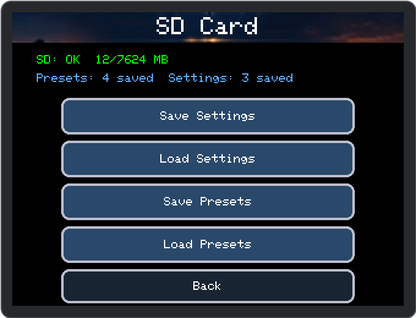

The two lines at the top show the card status (used / size) and how many preset and settings files are on it.

### Saving Settings

**What's saved**:
- Display settings (brightness, SWR thresholds)
- Motor settings (speed, acceleration, homing speed, homing offset/inversion,
  auto-disable, backlash compensation)
- Auto-tune settings (target SWR, sweep speed, time limit, power window, settle delay)
- Frequency memory settings (on/off, window, store SWR); the stored frequencies themselves are not part of the file
- SWR alarm threshold

**File created**: a new file every time — never overwrites a previous save. Named
`/staytuned/settings_<YYYYMMDD_HHMMSS>.json` if WiFi is connected and the
clock is NTP-synced (e.g. `settings_20260804_213045.json`), or
`/staytuned/settings_<NNNN>.json` with an auto-incrementing 4-digit counter
otherwise (e.g. `settings_0007.json`). The generated filename is shown in
the confirmation message.

### Loading Settings

Tap **Load Settings** to see a scrollable list of all saved settings files,
**newest first**. Tap a row to load that file's configuration values.

### Saving Presets

**What's saved**:
- All tuning presets (name, motor positions, SWR)
- On-screen button assignments for each preset (which of the 12 quick-access buttons it is assigned to)
- Physical button assignments for each preset (which MCP23017 hardware button it is assigned to, if any)

**File created**: a new file every time, using the same date/time-or-counter
naming as Settings above — e.g. `/staytuned/presets_20260804_213045.json`
or `/staytuned/presets_0007.json`.

### Loading Presets

Tap **Load Presets** to see a scrollable list of all saved preset files,
**newest first**. Tap a row to load it — all presets replace the current
preset list, and button assignments are restored from the file and saved
to flash.
**What's loaded**:
- All presets replace the current preset list
- On-screen and physical button assignments are restored from the file and saved to flash

**File required**: `/staytuned/presets.json`

**Note**: If the file was created on a different unit the button assignments may not match your layout — edit the `"button"` or `"physicalButton"` fields in the JSON file to reassign, or use the Preset List screen to reassign after loading.

**No files found**: If no matching files exist yet, tapping Load shows "No saved files found" instead of a list.

### SD Card Not Detected

If "Card Not Found" displays:
- Check SD card is inserted (contacts up)
- Verify FAT32 formatting
- Check SD module wiring
- Verify CS pin (GPIO 22)
- Try another SD card operation after inserting — mount is retried automatically

### JSON Format

Files are human-readable JSON and can be edited with any text editor.

**Example `/staytuned/presets_20260804_213045.json`**:
```json
[
  {
    "name": "20m CW",
    "motorCapacitor": 12500,
    "motorInductor": 8300,
    "freqMin": 14000,
    "freqMax": 14350,
    "swr": 1.2,
    "timestamp": 0,
    "button": 0,
    "physicalButton": 2
  },
  {
    "name": "40m SSB",
    "motorCapacitor": 24000,
    "motorInductor": 16000,
    "freqMin": 7000,
    "freqMax": 7300,
    "swr": 1.4,
    "timestamp": 0,
    "button": -1,
    "physicalButton": -1
  }
]
```

The `"button"` field is the on-screen quick-access button slot (0–11). Set to `-1` if not assigned.

The `"physicalButton"` field is the MCP23017 hardware button index (0–15). Set to `-1` if not assigned to a physical button. This field is only acted on if a port expander is present; it is silently ignored otherwise.

---

## About Screen

**Access**: ⚙ → About

The touchscreen About screen shows system info and provides two SD card firmware update actions.

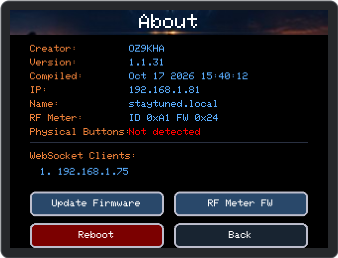

**Information Displayed**:
- **Creator**: OZ9KHA
- **Firmware Version**: Current software version
- **Compile Date/Time**: Build timestamp
- **IP Address**: Current WiFi IP address (or "Not connected" if WiFi is not joined)
- **WebSocket Clients**: List of connected web client IPs (refreshes every 2 seconds)

**Buttons**:

| Button | Colour | Condition | Action |
|--------|--------|-----------|--------|
| Update Firmware | Steel blue (active) | SD card available | Opens a scrollable list of `.bin` files found on the SD card |
| SD unavailable | Dim (inactive) | No SD card detected | No action |
| RF Meter FW | Steel blue (active) | SD card available and RF meter hardware detected | Opens a scrollable list of `.hex` files found on the SD card |
| Meter absent | Dim (inactive) | RF meter board not detected on I2C | No action |
| SD unavailable | Dim (inactive) | No SD card detected | No action |
| Reboot | Maroon | Always | Tap, then tap again within 3 s ("Tap again to reboot"): the tuner restarts, showing the boot picture with "Reboot Restarting..." |
| Back | Dark grey | Always | Return to the main screen |

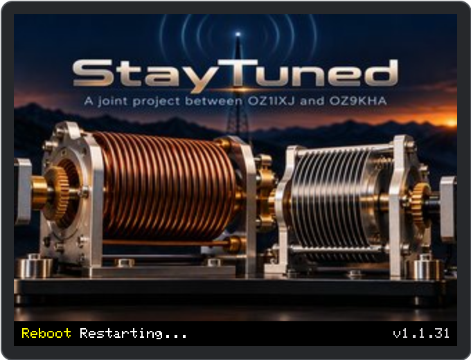

If the SD card is available but no matching files are found, the respective list screen shows "No .bin files found on SD card" or "No .hex files found on SD card" instead of a list.

---

## Firmware Update from SD Card

**Purpose**: Flash new firmware directly from the SD card — no USB cable or WiFi connection required.

Two independent, symmetric update flows are available from **⚙ → About**, each browsing the SD card for matching files and letting you pick which one to flash:
- **Tuner update** — browses `.bin` files, flashes the ESP32 itself
- **RF meter PIC update** — browses `.hex` files, flashes the RF meter board's PIC over I2C

**Requirements**:
- SD card inserted and readable
- One or more valid ESP32 firmware `.bin` files (e.g. exported from PlatformIO) in the root directory of the SD card, for a tuner update
- One or more valid RF meter `.hex` files in the root directory of the SD card, for an RF meter update
- Any filename with the matching extension is picked up — not a single fixed name — so you can keep multiple versions side-by-side (e.g. `firmware-1.1.16.bin`, `rf_meter-2.3.hex`)

### Tuner Firmware Procedure

1. **Copy** one or more `.bin` firmware files to the root of a FAT32-formatted SD card
2. **Insert** the SD card into the StayTuned device
3. Navigate to **⚙ → About**
4. The **"Update Firmware"** button will appear active (navy blue) if the SD card is available
5. **Tap the button** — a scrollable list of every `.bin` file found on the card is shown (up to 6 at a time, scroll for more)

   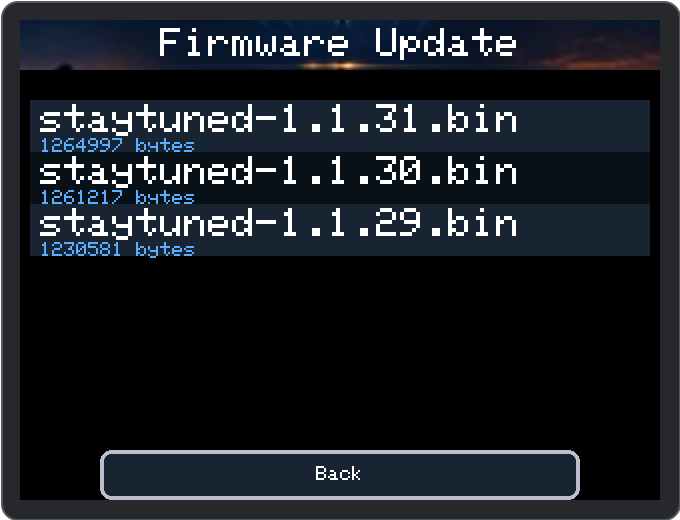

6. **Tap a file** — a confirmation dialog appears showing the filename and a "This will reboot the device" warning
7. **Tap Yes** to proceed (or Cancel to return to the list without flashing) — a progress screen appears:
   - File size is displayed
   - A sky blue progress bar fills as the firmware is written
8. On success: **"Success! Rebooting..."** — device reboots into the new firmware automatically
9. On failure: an error message is shown and the device returns to the file list

---

### RF Meter PIC Firmware Procedure

1. **Copy** one or more `.hex` firmware files to the root of a FAT32-formatted SD card
2. **Insert** the SD card into the StayTuned device
3. Navigate to **⚙ → About**
4. The **"RF Meter FW"** button appears active (steel blue) if the SD card is available and the RF meter board is detected on I2C
5. **Tap the button** — a scrollable list of every `.hex` file found on the card is shown (up to 6 at a time, scroll for more), newest version first
6. **Tap a file** — a confirmation dialog appears showing the filename and a "This will update the RF meter" notice
7. **Tap Yes** to proceed (or Cancel to return to the list without flashing) — a progress screen appears, running through phases:
  - Checking
  - Preparing
  - Erasing
  - Writing
  - Verifying
  - Committing
8. Target image is selected automatically using bootloader inactive-slot selection (`IMAGE_SELECT_AUTO`)
9. On success: success message is shown and the file list is restored
10. On failure: updater error text is shown and the file list is restored

**Canceling RF Meter Update**:
- While RF meter update is running, tap **Cancel** on the update screen
- Status changes to **Cancelling...** and updater exits safely
- After a cancelled or failed update the RF board returns to its previous firmware by itself, about 15 seconds later (its bootloader leaves update mode when no upload arrives), and the tuner finds the RF meter again

**Safety interlocks**: an RF meter flash is blocked (with an on-screen message) if the motors are currently running or an auto-tune is in progress — retry once the tuner is idle.

### Button States

| Button Text | Colour | Meaning |
|-------------|--------|---------|
| Update Firmware | Navy (active) | SD card available — tap to browse `.bin` files |
| SD unavailable | Dim (inactive) | No SD card detected |

RF meter update button states:

| Button Text | Colour | Meaning |
|-------------|--------|---------|
| RF Meter FW | Steel blue (active) | SD card available and RF meter hardware detected — tap to browse `.hex` files |
| Meter absent | Dim (inactive) | RF meter board not detected on I2C |
| SD unavailable | Dim (inactive) | No SD card detected |

### Getting a firmware.bin

**From PlatformIO**:
```
pio run -e esp32
```
The compiled binary is at `.pio/build/esp32/firmware.bin`.

**Via OTA build**:
```
pio run -e esp32-ota
```
Same output path — copy the binary to the SD card before uploading via the SD method. You can rename it or keep multiple versions side-by-side (e.g. `firmware-1.1.16.bin`) since the picker lists every `.bin` file present.

### Tips

- **Backup presets first**: Use SD Card → Save Presets/Save Settings before updating firmware — the update does not affect NVS (presets and settings are preserved)
- **Do not power off** during a tuner update — a failed partial write may require reflashing via USB
- Both pickers accept any filename with the matching extension (`.bin` or `.hex`) — no fixed name is required
- After a tuner update reboot, or an RF meter update completes, verify the new version on the About screen

### Comparison of Update Methods

| Method | Requires WiFi | Requires USB | Requirements |
|--------|:---:|:---:|---|
| USB (initial flash) | No | Yes | USB cable, PlatformIO |
| OTA via WiFi | Yes | No | Same WiFi network, browser |
| **SD Card tuner update** | **No** | **No** | **SD card with one or more `.bin` files** |
| **SD Card RF meter update** | **No** | **No** | **SD card with one or more `.hex` files** |

---

## SWR Alarms

**Purpose**: Alert operator to high SWR conditions that may damage equipment

### Alarm Behavior

#### When Alarm Triggers

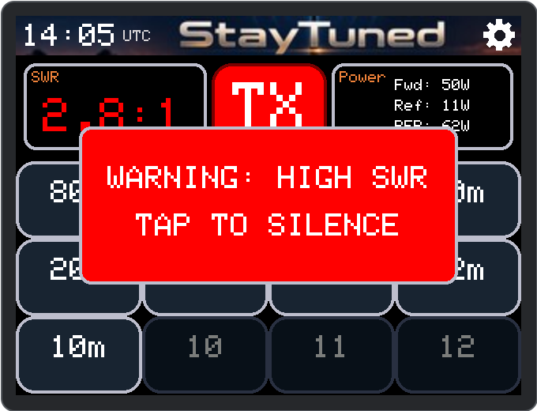

**Condition**: SWR exceeds alarm threshold (default 2.0) **AND** system is in Preset Mode

**Visual Alert**:
- Red popup window appears (center screen)
- Text: "WARNING: HIGH SWR" / "TAP TO SILENCE"
- Popup blocks all other screen interactions

**Audio Alert**:
- Continuous 1000Hz tone from speaker (GPIO 2)
- Sounds immediately when alarm triggers

**Blockage**:
- All buttons are disabled
- Menu cannot be opened
- Preset buttons do not respond
- **ONLY** the alarm popup can be touched

#### Alarm in Manual Mode

**Important**: Alarms do **NOT** trigger in Manual Mode.

**Reason**: High SWR is expected and normal during manual tuning. Operator is actively adjusting and monitoring.

**Effect**: You can tune freely without alarm interruptions.

#### Silencing the Alarm

1. **Tap anywhere on red popup** (or **Silence** on the web Presets page)
2. Audio tone stops immediately
3. Popup remains visible (as reminder)
4. Screen interactions remain blocked

**Note**: Alarm cannot be dismissed while SWR is still high - only silenced.

#### Alarm Clearing

**Automatic**: When SWR drops below threshold
- Popup disappears
- Screen returns to normal operation
- All buttons become responsive

**Manual**: Switch to Manual Mode
- Alarm is disabled in Manual Mode
- Popup cleared
- Allows manual adjustment to reduce SWR

### Alarm Configuration

#### Setting Alarm Threshold

1. ⚙ → Settings
2. Find "SWR Alarm Threshold"
3. Adjust with [-] [+] buttons
4. **Range**: 1.0-10.0 (the RF meter board's own alarm covers 1.5-5.0)
5. **Default**: 2.0
6. **Increment**: 0.1 per tap

The tuner also writes the threshold to the RF meter board, about 1 s after your last change and at boot if the board holds a different value. The board saves it, and the CLI `r` command shows it (`[0x19] SWR alarm thresh`). For a setting outside 1.5-5.0 the board keeps its nearest limit, and only the tuner's own check raises the alarm.

**Recommendations**:
- **2.0**: Standard for solid-state PAs
- **3.0**: More tolerant for tube rigs
- **1.5**: Conservative for QRP

#### Disabling Alarms

Alarms cannot be permanently disabled, but are automatically:
- **Disabled** in Manual Mode
- **Enabled** in Preset Mode

**Workaround**: Stay in Manual Mode if alarms are unwanted.

### Troubleshooting False Alarms

If alarm triggers unexpectedly:

1. **Check SWR reading**: Is it actually high?
2. **Verify threshold**: Settings → SWR Alarm
3. **Calibrate SWR bridge**: Ensure proper coupling factor
4. **Check RF connections**: Loose connections cause reflections
5. **Reduce power**: Test with low power first
6. **Re-tune**: Preset may have drifted, retune and save

---

## WiFi & OTA Updates

### WiFi Connection

#### First-Time Setup

1. **Power on device** with WiFi enabled
2. **Access Point created**: 
   - SSID: **"StayTuned"**
   - Password: **"staytuned2026"**
3. **Connect** from phone/computer
4. **Captive portal** opens automatically
5. **Select your WiFi network** from list
6. **Enter password**, and optionally a **Tuner name** (see [mDNS Hostname](#mdns-hostname)), then save
7. **Device connects** to your network
8. **AP shuts down** after successful connection

#### Status Indicator

- **WiFi icon** shown on Main Screen header
- **Connected**: Icon present
- **Not connected**: Icon absent

#### Reconnection

Device automatically reconnects to saved network on boot:
- **Max retries**: 20 attempts
- **Retry interval**: 30 seconds
- **Fallback**: Creates AP if all retries fail

### mDNS Hostname

The tuner is reachable as **`<name>.local`**; the default name is **`staytuned`** (`staytuned.local`). With several tuners on one network, give each its own name.

**Setting the name**:
- During WiFi setup: the **Tuner name** field on the setup page
- Later: web page → **Settings** → **Network** → **Tuner name**, then **Save**. The new `name.local` answers at once; OTA updates and the name your router shows use it after the next reboot
- Valid names: 1-31 characters, `a-z`, `0-9` and `-` (not first or last). Capitals are turned into lowercase; a trailing `.local` is ignored
- The touchscreen **About** screen and the web **About** page show the current name
- The name is not part of the SD card settings file, so restoring settings from another tuner keeps this tuner's name

**Uses**:
- OTA updates: `pio run -e esp32-ota --target upload` resolves the name via mDNS (not HTTP — the espota protocol). For a renamed tuner, add `--upload-port <name>.local` or change `upload_port` in `platformio.ini`
- Web interface: `http://<name>.local`
- REST API access
- Network identification (also the hostname your router lists for the tuner)

### OTA (Over-The-Air) Updates

**Purpose**: Update firmware without a USB cable, from a PC on the same network.

**Important**: OTA updates use the `ArduinoOTA` (espota) protocol, not a browser upload page — there is no firmware-upload form at `http://staytuned.local`. Updates are pushed from a PC running PlatformIO.

**Requirements**:
- Device connected to WiFi
- PC on the same network with [PlatformIO](https://platformio.org/) installed
- This project's source checked out (or at minimum, its compiled `.bin` and `platformio.ini`)

#### Performing an OTA Update

1. On your PC, open a terminal in the project directory
2. Run:
   ```bash
   pio run -e esp32-ota --target upload
   ```
3. PlatformIO builds the firmware, finds the device via mDNS (`staytuned.local`), and pushes it over WiFi
4. Progress is shown as a percentage in the terminal
5. Device reboots automatically into the new firmware once the transfer completes

If `staytuned.local` doesn't resolve, use `pio run -e esp32-ota-ip --target upload` after editing `upload_port` in `platformio.ini` with the device's IP address (see the About screen or your router for the current IP).

**Tips**:
- Use a stable WiFi connection — an interrupted transfer can leave the device unable to boot, requiring a USB reflash
- Backup presets/settings to SD card first (see [SD Card Operations](#sd-card-operations))
- After reboot, verify the new version on the About screen

#### OTA Security

- **Password**: None by default — anyone on the network can push an OTA update
- **To secure**: Set `OTA_PASSWORD` in `include/config.h` and recompile/reflash

---

## Web Interface

The tuner has its own web pages. With a phone, tablet or PC on the same network you can watch the SWR and power, load and edit presets, tune by hand or automatically, and change the settings, without standing at the tuner. The touchscreen keeps working at the same time, and everything stays in step: a preset loaded in the browser shows on the touchscreen, and the other way round.

A few things are only on the touchscreen: hardware and touch calibration, SD card backup and restore, firmware updates, WiFi on/off, forget WiFi and factory reset.

### Opening the Web Interface

1. Make sure the tuner is connected to your WiFi (see [WiFi & OTA Updates](#wifi--ota-updates)) and that your phone or PC is on the same network.
2. Open a browser and go to **`http://staytuned.local`**. If you gave the tuner another name, use that: `http://<name>.local`.
3. If the page doesn't open, or every click takes a few seconds, use the tuner's **IP address** instead, e.g. `http://192.168.1.103`. You find it on the touchscreen under **⚙ → About** (`IP:`), or on the web **About** page. Some PCs and phones resolve `.local` names slowly or not at all; the IP address always works.

**Tip**: bookmark the page, or on a phone use **Add to Home Screen**, so the tuner opens like an app. If the address changes after a reboot, ask your router to always give the tuner the same IP address (a DHCP reservation).

The pages work in any current browser, in portrait and landscape. There are four of them, reached with the tabs at the top: **Presets**, **Motors**, **Settings** and **About**. The live values (SWR, power, frequency, positions) update by themselves about ten times a second.

### The Pages at a Glance

| Presets | Motors |
|:--:|:--:|
| 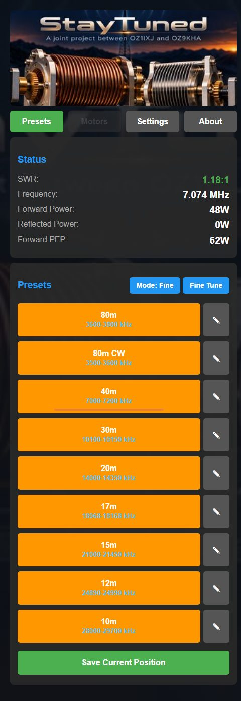 | 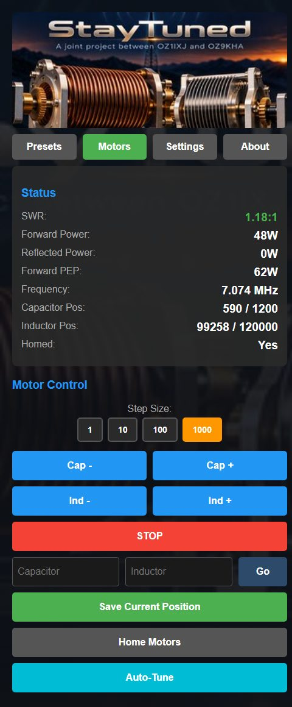 |
| **Presets** (start page): live status, the presets, fine tune and auto mode | **Motors**: move the motors by hand, go to a position, home, auto-tune |

| Settings | About |
|:--:|:--:|
| 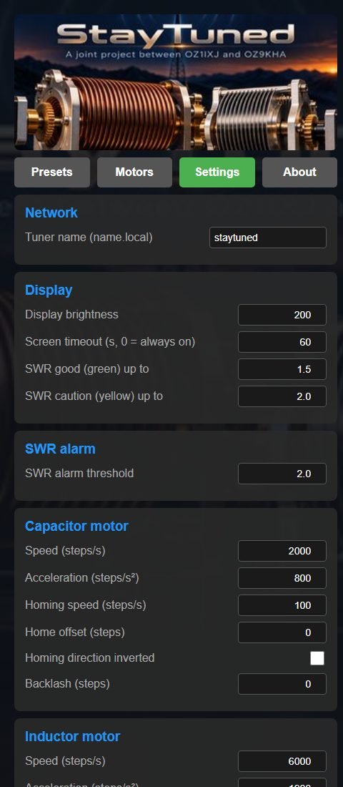 | 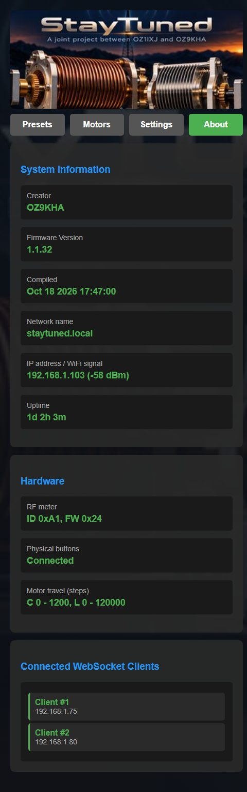 |
| **Settings**: all touchscreen settings plus the tuner's network name | **About**: firmware, network, uptime, hardware and connected browsers |

**Status panel** (Presets and Motors pages):
- **SWR**: green, yellow or red, using the same limits as the touchscreen
- **Frequency**: the frequency the RF meter measures while you transmit; `--` without RF
- **Forward / Reflected Power** and **Forward PEP**, in watts
- On the Motors page also the **capacitor and inductor positions** (current / travel limit, e.g. `590 / 1200`) and whether the motors are **Homed**

### Everyday Tasks

#### Load a preset

On the **Presets** page, click the preset's name (the orange button). The motors move to its position:
- A **blue bar** under the name while the motors move, a **copper bar** once they are there. The same bar shows on the touchscreen button.
- While the motors move, the preset buttons are disabled; wait for the copper bar.
- Presets can't be loaded while you transmit (see [When the Tuner Says No](#when-the-tuner-says-no)).

#### Fine tune and auto mode

- **Fine Tune** (next to the Presets heading) starts a fine tune from the loaded preset, exactly like the FINE TUNE button on the touchscreen. Load a preset first. Then transmit a carrier; the progress shows under the buttons. The tune ends when you remove RF. **Abort** stops it before RF is seen.
- **Mode: Fine / Mode: Auto** switches between fine tune and auto mode (the same as holding FINE TUNE on the touchscreen). In auto mode the tuner follows your transmit frequency by itself; its status line shows what it is doing. The button is disabled without the RF meter board. See [Auto Mode](#auto-mode) for how it works.

#### Save the current position as a preset

Click **Save Current Position** (Presets or Motors page), enter a name (up to 20 characters) and, if you like, the frequency range in kHz, then **Save**. A preset with the same name is overwritten.

#### Edit a preset

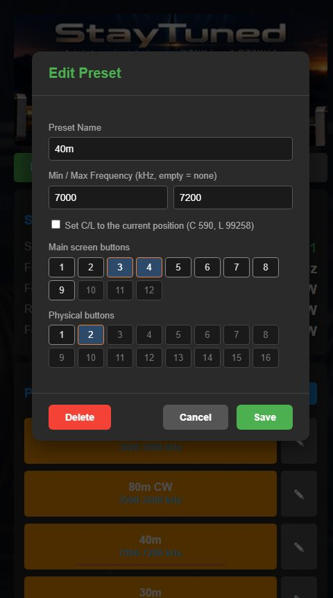

Click **✎** next to the preset. The editor offers the same changes as the touchscreen preset editor and its Assign dialog:
- **Preset Name** and **Min / Max Frequency** (kHz; leave empty for no range)
- **Set C/L to the current position**: tick it to store where the motors are now (shown in brackets) as the preset's position. Use it after you have improved the tuning by hand. The current SWR is stored with it when RF is present.
- **Main screen buttons** 1-12: the buttons on the touchscreen main screen that load this preset. Highlighted (blue with a copper rim) = on this preset. White = on another preset; hold the mouse over it to see which. Grey = free. Click a number to switch it on or off. Choosing a button that is on another preset moves it to this one.
- **Physical buttons** 1-16: the same for the external push buttons; only shown when the button board is connected.

Click **Save**. The tuner applies the change a moment later; the list and the touchscreen update by themselves.

#### Delete a preset

Open the editor with **✎** and click **Delete** (red), then confirm. The preset is gone for good; its buttons become free. The other presets keep their buttons.

#### Tune by hand

On the **Motors** page:
1. Choose a **Step Size**: 1, 10, 100 or 1000 steps per click.
2. Click **Cap −** / **Cap +** and **Ind −** / **Ind +** while you watch the SWR. Transmit a low-power carrier for a live SWR reading.
3. **STOP** stops any move (the motors slow down to a stop): a manual move, a move to a position or a preset load.
4. **Go to position**: type a capacitor and/or inductor position (in steps, between 0 and the travel limit shown in the status) and click **Go**. Leave a box empty to keep that motor where it is.
5. When the SWR is good, use **Save Current Position**, or update an existing preset with **Set C/L to the current position** in its editor.

#### Run an auto-tune

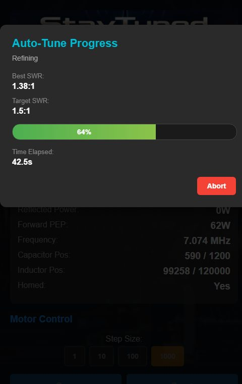

1. Transmit a low-power carrier (within the auto-tune power window, see [Auto-Tune](#auto-tune)).
2. On the **Motors** page click **Auto-Tune** and confirm.
3. A progress window shows the status, the best SWR so far, the target SWR, a progress bar and the elapsed time. The touchscreen shows the tune as well.
4. **Abort** stops the tune. When it has finished, **Close** returns to the page.

The motor controls are locked while a tune runs, and the Motors tab on the Presets page is greyed out.

#### Home the motors

On the **Motors** page click **Home Motors** and confirm. The tuner runs the same homing as at power-on: each motor drives to its limit switch and sets position 0. The touchscreen shows the progress with an **ABORT** button. The web page doesn't update until homing is finished (about 10-30 s). Homing is only needed if a motor has lost steps; it runs by itself at power-on.

#### Change settings

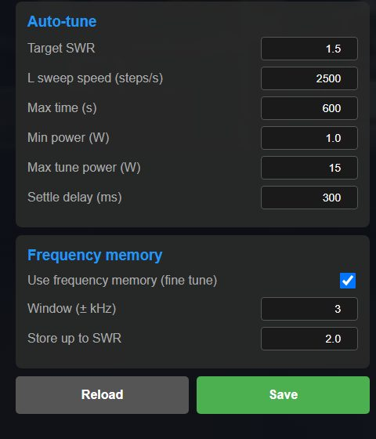

The **Settings** page has the same settings as the touchscreen Settings screen, in groups: **Network**, **Display**, **SWR alarm**, **Capacitor motor**, **Inductor motor**, **Auto-tune** and **Frequency memory** (see [Settings & Configuration](#settings--configuration) for what each one does).
1. Change the values you want.
2. Click **Save** at the bottom. A message confirms it, and the touchscreen shows the new values.
3. **Reload** reads the current values from the tuner again and discards unsaved changes.

**Tuner name** (Network group): the name the tuner answers to on the network (`<name>.local`). Use 1-31 characters: letters, digits and `-`. The new name works at once; open the pages with the new address afterwards.

#### Silence the SWR alarm

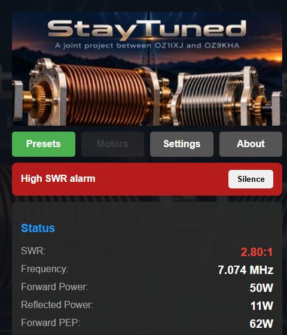

When the SWR goes above the alarm threshold, a red **High SWR alarm** bar appears at the top of the Presets page, together with the popup and tone on the touchscreen. Click **Silence** to stop the tone (the same as tapping the popup); the bar then disappears. The popup on the touchscreen stays until the SWR is back below the threshold. Lower the power or retune.

#### Check the tuner's state

The **About** page shows:
- **Firmware Version** and **Compiled** date
- **Network name**, **IP address and WiFi signal** (in dBm; above about -70 dBm is fine)
- **Uptime** since the last restart
- **Hardware**: the RF meter (ID and firmware) or "Not detected", whether the physical buttons are connected, and the motor travel in steps
- **Connected WebSocket Clients**: the browsers that have the pages open

It refreshes every 2 seconds.

### When the Tuner Says No

Some actions are refused for safety, or because the tuner is busy. The page shows a message with the reason:

| Message | Why | What to do |
|---------|-----|------------|
| Cannot change preset while transmitting / Cannot move the motors while transmitting | You transmit (forward power 1 W or more); changing the tuning under power can damage the tuner | Unkey, then try again. The Motors tab is greyed out while RF is present. **Go to position** is refused the same way; the − / + buttons are not |
| Motors are still moving to the previous preset / Motors are moving | A move isn't finished yet | Wait for the copper bar or the positions to stop changing, or press **STOP** |
| Auto-tune running | An auto-tune or fine tune owns the motors | Wait for it to finish, or abort it |
| A preset is being edited on the tuner | The preset editor is open on the touchscreen | Close it on the touchscreen, then try again |
| Previous change still pending | The tuner hasn't finished applying the previous change | Try again after a moment |
| RF meter not connected | Fine tune and auto mode need the RF meter board | Check the RF meter connection (About page) |
| Position out of range | The position is below 0 or above the travel limit | Use a value within the limits shown in the status |
| Another preset has that name | Preset names must be unique | Choose another name |

### Web Pages and Touchscreen Together

- The touchscreen and any number of browsers can be used at the same time. They all show the same live values, and a change made in one place shows everywhere: a preset loaded on the touchscreen gets its copper bar in the browser, a preset edited in the browser changes on the touchscreen main screen.
- Only one action at a time reaches the motors. If something is already moving or tuning, the next action is refused with a message (see above) rather than mixed in.
- The touchscreen shows the same screens it would if you had pressed the button there (auto-tune progress, homing, alarm popup).

### Troubleshooting Web Interface

| Problem | Solution |
|---------|----------|
| Page doesn't open at `staytuned.local` | Use the IP address from ⚙ → About on the touchscreen. Check that the PC or phone is on the same WiFi, and that WiFi is enabled on the tuner (Settings) |
| Every click takes several seconds | The `.local` name is resolved slowly on this PC; use the IP address |
| Values show `--` | The page has lost its connection to the tuner; it reconnects by itself every few seconds. Check the WiFi signal (About page) |
| The page stopped updating for a while | Normal during homing; it continues when homing is done |
| Preset buttons or the Motors tab are greyed out | The motors are moving, a tune is running, or you are transmitting (see [When the Tuner Says No](#when-the-tuner-says-no)) |
| Mode and Fine Tune buttons are disabled | The RF meter isn't connected, or no preset is loaded (Fine Tune) |
| A change doesn't show at once | Changes are applied a moment after the tuner confirms them; the page refreshes by itself shortly after |
| Page looks old after a firmware update | Reload the page (Ctrl+F5 / pull down to refresh) |

### REST API

For programmatic access, StayTuned provides a REST API. See **[REST_API.md](REST_API.md)** for complete endpoint documentation with request/response examples.

**Quick Reference**:
- `GET /api/status` - Get current system status
- `GET /api/presets` - List all presets
- `POST /api/preset/load` - Load a preset
- `POST /api/preset/save` - Save current position
- `POST /api/motor` - Move motor by steps
- `POST /api/home` - Home motors
- `GET /api/settings` - Read all settings
- `POST /api/settings` - Change settings
- `POST /api/preset/update`, `POST /api/preset/delete` - Edit or delete a preset (name, range, C/L, buttons)
- `POST /api/motor/goto`, `POST /api/motor/stop` - Move to a position, stop the motors
- `POST /api/alarm/silence` - Silence the SWR alarm

**Authentication**: None (relies on network security)

**Rate Limiting**: None (use responsibly)

### Remote Serial Debugging (Advanced)

Gated by `WIFI_ENABLED` in `include/config.h` (default `true`) — the telnet debug server starts automatically once WiFi connects. Note that the RF meter PCB repurposes the USB TX/RX pins for I2C, so telnet is the *only* way to see debug output while it's connected.

1. **Connect** to same WiFi network
2. **Open telnet**: `telnet staytuned.local 3232`
3. **View** serial output remotely
4. **Send** serial commands
5. **Multiple clients** supported (up to 4)

**Use cases**:
- Remote troubleshooting
- Embedded installation monitoring
- Development/debugging

### Disabling WiFi

**Why**: Slightly faster boot, reduced power consumption, no RF interference

**Method**:
1. ⚙ → Settings → Scroll down
2. Tap **"WiFi Toggle"**
3. Message: "WiFi disabled on next boot"
4. **Reboot** device
5. WiFi startup skipped

**Re-enabling**: Repeat process (button toggles state)

### Forgetting WiFi Credentials

**Purpose**: Clear saved network to reconfigure

**Method**:
1. ⚙ → Settings → Scroll down
2. Tap **"Forget WiFi"**
3. **Confirmation dialog**: "YES" / "NO"
4. Tap **"YES"** to confirm
5. Message: "WiFi Forgotten - Reboot to reconfigure"
6. **Reboot** device
7. AP mode starts (first-time setup)

**Use cases**:
- Changing WiFi networks
- Moving device to new location
- Troubleshooting connection issues

---

## Appendix A: Hardware Connections

### Display & Touch
- **Display**: ILI9341 (320×240, SPI)
- **Touch**: XPT2046 (resistive, SPI)
- **Backlight**: GPIO 17 (PWM controlled)

### Motors
- **Motor 1 (Capacitor)**: Step=GPIO25, Dir=GPIO26, Enable=GPIO27, Limit=GPIO32
- **Motor 2 (Inductor)**: Step=GPIO12, Dir=GPIO13, Enable=GPIO14, Limit=GPIO33
- **Drivers**: TB6600 (opto-isolated)

### RF Meter (Primary SWR Source)
- **Interface**: I2C, address `0x30`
- **Pins**: SDA=GPIO1 (repurposed UART0 TX), SCL=GPIO3 (repurposed UART0 RX) — USB serial is unavailable while the meter is connected; use telnet debugging instead
- **Provides**: Forward/reflected power (W), SWR (×10), frequency (Hz) — read as a 14-byte register burst at ~20 Hz (50ms)

### Legacy SWR Bridge (disabled by default, `ADC_ENABLED false`)
- **Forward Power**: GPIO 36 (ADC1_CH0, VP)
- **Reflected Power**: GPIO 39 (ADC1_CH3, VN)
- **Voltage Range**: 0-3.3V

### Audio/Indicators
- **Speaker**: GPIO 2 (PWM)
- **Status LED**: GPIO 5 (optional)

### SD Card (Optional)
- **CS**: GPIO 22
- **Shared SPI**: MOSI=23, MISO=19, SCK=18

### Power
- **ESP32**: 5V (via USB or regulator)
- **Display**: 5V (typically from ESP32 board)
- **Motors**: 12-24V (separate supply)

---

## Appendix B: Quick Reference Card

### Screen Navigation
- **Main**: Default screen, tuning and presets
- **Presets**: ⚙ → Presets
- **Settings**: ⚙ → Settings
- **SD Card**: ⚙ → SD Card
- **About**: ⚙ → About (versions, firmware updates, Reboot)
- **Preset / Manual mode**: ⚙ → top row switch
- **Calibration**: Settings → Hardware Calibration
- **Back**: Use "Back" button on each screen

### Emergency Actions
- **Stop Motors**: Manual Mode → [STOP] button
- **Re-Home Motors**: About → **Reboot** (tap twice), or power-cycle the device
- **Disable Alarm**: Switch to Manual Mode
- **Forget WiFi**: Settings → **Forget WiFi Credentials**
- **Factory Reset**: Settings → **Factory Reset** (end of the list, confirmation)

### Serial / Telnet Commands (read-only)
Telnet to port 3232 (or USB at 115200 baud in a USB build). The commands only show data; nothing can be changed from them:
- `s` - System status (positions, SWR, power, presets, backlight, WiFi)
- `r` - RF board registers and power calibration
- `p` - Preset count
- `fm` / `fm list` / `fm auto` - Frequency memory status / entries, auto mode status
- `?` - Help

### Default Values
- **Brightness**: 200 (range 20-255)
- **Screen Timeout**: 60 s
- **SWR Alarm**: 2.0
- **SWR Good**: 1.5 (green/yellow)
- **SWR Caution**: 2.0 (yellow/red)
- **MC / ML Speed**: 2000 steps/s
- **MC / ML Accel**: 1000 steps/s²
- **MC / ML Home Offset**: 0 steps
- **MC / ML Homing Dir**: Normal
- **MC / ML Backlash**: 0 steps (off)
- **Motor Auto-Disable**: On
- **Motor End Positions**: 500,000 steps (set your own in Hardware Calibration)
- **Auto-tune**: target SWR 1.5, power window 1-20 W, max time 600 s
- **Frequency memory**: on, window 3 kHz, store up to SWR 1.5
- **Auto mode**: off
- **Step Size**: 1000 (manual mode)

---

## Appendix C: Troubleshooting

### Display Issues

| Problem | Solution |
|---------|----------|
| Blank screen | Check 5V power, backlight connection (GPIO 17) |
| Dim display | Settings → Brightness → Increase value |
| Touch unresponsive | Settings → Touch Calibration |
| Touch offset | Redo touch calibration, use stylus for accuracy |
| Screen flickers | Check SPI connections, lower SPI speed if modified |

### Motor Issues

| Problem | Solution |
|---------|----------|
| Motors don't move | Check enable pins, TB6600 power, 12-24V supply |
| Homing fails | Verify limit switches (GPIO 32/33), check wiring polarity |
| Motors move wrong direction | Settings → Hardware Cal → Re-home motors |
| Erratic movement | Check TB6600 current setting, mechanical binding |
| Position drift | Home motors periodically, check for missed steps |
| First move after a direction change is shorter than the next | Load-induced microstep lag: set MC/ML Backlash in Settings (see [Motors](#motors)), or raise the TB6600 current |
| First step after a direction change goes the wrong way | Update to current firmware (adds the TB6600 DIR setup time); check DIR wiring |

### SWR Reading Issues

| Problem | Solution |
|---------|----------|
| SWR always 1.0 / reads 0W | Verify the RF meter PCB acknowledges on I2C (address 0x30); check SDA=GPIO1/SCL=GPIO3 wiring. If using the legacy ADC bridge instead, confirm `ADC_ENABLED true` and check GPIO 36/39 wiring |
| SWR too high | Check RF connections; if on the legacy ADC path, verify coupling factor in `config.h` |
| SWR fluctuates | On the legacy ADC path: add capacitors to ADC inputs, increase `ADC_SAMPLES` |
| False alarms | Increase alarm threshold; verify RF meter/SWR bridge calibration |

### WiFi Issues

| Problem | Solution |
|---------|----------|
| AP not appearing | Check WiFi not disabled in settings, reboot device |
| Reboots about every 30 s with WiFi disabled | Fixed in current firmware; update. Older builds tried to reconnect WiFi in the background even when disabled |
| Can't connect to AP | Verify password "staytuned2026", check WiFi band (2.4GHz only) |
| Loses connection | Check router signal, increase retry count in `config.h` |
| OTA not accessible | Verify `staytuned.local` resolves, try IP address directly |

### Preset Issues

| Problem | Solution |
|---------|----------|
| Can't save preset | Check flash memory not full (max 50), try deleting old presets |
| Preset doesn't load | Verify motors are homed, check positions are within range |
| Button assignment lost | Re-assign in Preset List, ensure assignment saved |
| Preset loads wrong position | Delete and re-save, verify motors don't skip steps |

---

## Appendix D: Specifications

### System Specifications
- **Processor**: ESP32 (240MHz dual-core)
- **Memory**: 520KB RAM, 4MB Flash
- **Display**: 3.2" TFT (320×240), ILI9341 driver
- **Touch**: XPT2046 resistive (4-wire)
- **Storage**: Internal flash + optional SD card (FAT32)
- **WiFi**: 802.11 b/g/n (2.4GHz)
- **OTA**: ArduinoOTA (espota protocol), pushed via PlatformIO CLI — no browser upload page

### Motor Specifications
- **Type**: Stepper motors (NEMA 17/23 compatible)
- **Drivers**: TB6600 (opto-isolated)
- **Max Speed**: 4000 steps/second
- **Max Acceleration**: 2000 steps/sec²
- **Position Range**: 0-50,000 steps (configurable)
- **Homing**: Limit switches (active LOW)

### SWR Monitor
**Primary (I2C RF Meter PCB)**:
- **Interface**: I2C, address `0x30`, 100 kHz bus
- **Update Rate**: ~20 Hz (50ms)
- **Provides**: Forward/reflected power (0-1000W), SWR ×10, frequency (Hz) — no on-device calibration needed

**Legacy (analog ADC bridge, disabled by default)**:
- **ADC Resolution**: 12-bit (0-4095)
- **Sample Rate**: ~20 Hz (50ms update)
- **Oversampling**: 32 samples averaged
- **Coupling Factor**: Configurable (default 100:1)

**SWR Range** (either path): 1.0-10.0+ (practical limit ~5.0)

### Power Requirements
- **ESP32 + Display**: ~300mA @ 5V
- **Motors**: Variable, depends on load (typically 1-2A per motor @ 12-24V)
- **Total System**: ~5-10W typical operation

### Environmental
- **Operating Temp**: 0-50°C (limited by display)
- **Storage Temp**: -20-70°C
- **Humidity**: 20-80% RH (non-condensing)

---

## Appendix E: Firmware Information

- **Version**: 1.1.23
- **Build Platform**: PlatformIO
- **Framework**: Arduino (ESP32)
- **Key Libraries**:
  - TFT_eSPI (display driver)
  - TFT_eWidget (button widgets)
  - ThingPulse XPT2046 Touch (touch controller)
  - AccelStepper (motor control)
  - ESPAsyncWiFiManager (WiFi configuration portal)
  - ESPAsyncWebServer / AsyncTCP (web UI, REST API, WebSocket)
  - ArduinoJson (preset/settings storage)
  - ArduinoOTA (OTA firmware updates — built into the ESP32 core, not a separate lib_deps entry)

### Configuration Files
- **`platformio.ini`**: Build configuration, pin assignments
- **`include/config.h`**: System parameters, pin definitions
- **`include/TFT_eSPI_Setup.h`**: Display configuration reference

### Customization
All system parameters can be modified in `config.h`:
- Pin assignments
- Motor limits and speeds
- SWR thresholds and coupling factor
- Display brightness range
- WiFi credentials and OTA settings
- Serial debugging options

---

## Support & Additional Information

### Documentation
- **README.md**: Project overview and status
- **REQUIREMENTS.md**: Detailed feature specifications
- **REQUIREMENTS_COMPLIANCE.md**: Implementation checklist
- **REST_API.md**: REST API & WebSocket reference with examples
- **AUTO_TUNE_REQUIREMENTS.md**: Auto-tune algorithm strategy and constraints
- **QUICK_START.md**: Quick reference for common operations
- **SCREEN_MOCKUPS.md**: UI layout reference

### Development
- **Repository Structure**:
  - `src/` - Main application code
  - `include/` - Header files
  - `extra_script.py` - Build automation

### Known Limitations / Future Enhancements
Auto-tune, the web interface, and REST API are already implemented (see [Auto-Tune](#auto-tune) and [Web Interface](#web-interface)). What's still outstanding:
- Graphical UI elements — SWR meter arc widget, power bars, preset scatter-plot visualization (text-only display today; backend data already exists)
- Data logging / tuning history — no persistent history or analytics yet
- System self-test routine, power management/sleep modes
- Long-term stability / full integration testing (see [REQUIREMENTS_COMPLIANCE.md](REQUIREMENTS_COMPLIANCE.md))

---

**End of User Guide**

*Last Updated: August 2026*  
*Document Version: 1.3*  
*Firmware Version: 1.1.16*
